# Задание 30. Локальная LLM как приватный сервис

> Разверните локальную LLM как сервис: на VPS или домашнем сервере, с HTTP API, с возможностью чата.
> Проверьте: доступ к модели по сети, стабильность при нескольких запросах, базовые ограничения
> (rate limit / max context). Результат: приватный AI-сервис на базе локальной LLM.

Домашний сервер — этот Mac M1 8 ГБ. Модель — `qwen2.5:3b` в Ollama 0.34.4. Перед Ollama стоит свой
HTTP-шлюз на stdlib: ключи, rate limit, очередь, лимиты контекста. API совместимо с OpenAI, так что
подключается любой OpenAI-клиент. Есть веб-чат (открывается с телефона в той же Wi-Fi) и CLI-чат.
Запросы не уходят дальше локальной сети.

## Запуск

```bash
ollama serve &                      # слушает только 127.0.0.1:11434
ollama pull qwen2.5:3b
cd 30-private-llm-service
python3 server.py --init-keys       # один раз: owner (10/мин) и loadtest (600/мин) в корневой .env
python3 server.py                   # 0.0.0.0:8030, печатает адрес в локальной сети
```

```
Приватный AI-сервис · qwen2.5:3b · Ollama 0.34.4 (только 127.0.0.1)
  этот компьютер:  http://localhost:8030
  локальная сеть:  http://192.168.0.181:8030
  ключи: owner sk-local-…… 10/мин, loadtest sk-local-…… 600/мин
  лимиты: окно 4096, ответ ≤512, тело ≤256 КБ, в модели 2, очередь 6
```

Клиенты:

```bash
# браузер (с телефона тоже): http://192.168.0.181:8030 → вставить ключ → чат со стримингом
python3 client.py --url http://192.168.0.181:8030             # CLI-чат с историей
curl http://192.168.0.181:8030/v1/chat/completions \
  -H "Authorization: Bearer $KEY" \
  -d '{"messages":[{"role":"user","content":"Привет"}],"max_tokens":100}'
python3 service_demo.py             # проверка: сеть, ключи, нагрузка, rate limit, контекст (~5 мин)
python3 make_cast.py                # demo.svg
```

Любой OpenAI SDK: `base_url="http://192.168.0.181:8030/v1"`, `api_key=<ключ>`.

## Как устроено

```
телефон / ноутбук / curl ─HTTP─▶ server.py :8030 (0.0.0.0) ──▶ Ollama 127.0.0.1:11434
                                 │ 401  ключ (Bearer, сравнение за постоянное время)
                                 │ 413  тело > 256 КБ
                                 │ 429  token bucket на ключ + Retry-After
                                 │ 400/413  messages, max_tokens, оценка токенов > окна
                                 │ 503  в модели 2, в очереди 6 — остальным сразу отказ
                                 └ num_ctx=4096 и num_predict≤512 ставит шлюз, не клиент
```

| Файл | Что делает |
|---|---|
| `limits.py` | логика дня: ключи из `.env`, `TokenBucket`, `check_request` (оценка токенов), `Gate` (очередь), `Stats` |
| `server.py` | тонкий HTTP: `/v1/chat/completions` (JSON и SSE-стрим), `/v1/models`, `/stats`, `/health`, страница чата |
| `local_llm.py` | клиент Ollama из дней 26–29, плюс стриминг |
| `client.py` | CLI-чат по сети на urllib, разбор SSE, понятные ошибки 429/413 |
| `service_demo.py` | проверка по LAN-адресу, пишет `data/service_result.json` |

| Лимит | Значение | Ответ |
|---|---|---|
| Ключ | `LLM_SERVICE_KEYS=имя:ключ:в_минуту,…` | 401 `invalid_api_key` |
| Частота | owner 10/мин (ведро на 3), loadtest 600/мин | 429 `rate_limit_exceeded` + `Retry-After` |
| Тело | 256 КБ | 413 `body_too_large` |
| История | 40 сообщений | 413 `too_many_messages` |
| Контекст | оценка промпта + max_tokens ≤ 4096 | 413 `context_length_exceeded` |
| Ответ | max_tokens ≤ 512, иначе молча обрезается до 512 | `finish_reason: length` |
| Нагрузка | 2 в модели + 6 в очереди, ожидание ≤120 с | 503 `server_busy` + `Retry-After` |

**Почему окно задаёт шлюз.** Во-первых, если `num_ctx` разный у разных запросов, Ollama перезагружает
модель (видели в дне 29). Во-вторых, и это главное, Ollama молча режет длинный промпт (блок
«Контекст» ниже). У Ollama нет API токенизатора, поэтому шлюз оценивает длину по символам.
Коэффициенты откалиброваны по `prompt_eval_count` на qwen2.5:3b:

- Конституция (85% кириллицы): 3,66–3,85 символа на токен; английский: 3,7–3,8;
- без `system` шаблон Qwen подставляет свой «You are Qwen…» — +30 токенов, каждое сообщение — +6;
- в формуле взято 3,3 символа на токен, чтобы промахиваться в большую сторону.

## Результаты

`python3 service_demo.py`, 2026-10-12. Все запросы шли на `http://192.168.0.181:8030` (LAN-адрес,
не localhost). Полный лог всех четырёх прогонов лежит в [`data/demo_log.txt`](data/demo_log.txt),
данные — в `data/service_result.json`.

### 1. Доступ по сети и ключи

| Проверка | Результат |
|---|---|
| `GET /health`, `GET /` по 192.168.0.181:8030 | 200, 200 |
| Ollama по 192.168.0.181:11434 | **закрыт** (Connection refused) — модель снаружи недоступна |
| Ollama по 127.0.0.1:11434 | открыт — только для шлюза |
| без ключа / чужой ключ / `/stats` без ключа | 401 / 401 / 401 |
| свой ключ | 200 |
| `client.py --url http://192.168.0.181:8030`, два хода | второй ответ помнит имя из первого |

### 2. Стабильность

Волны одновременных запросов: «Сколько будет 17 + 25? Объясни в двух-трёх предложениях…»,
`max_tokens=120`, `temperature=0`, ключ loadtest. «42» — сколько ответов содержат правильное число.

| Одновременно | Коды | «42» | Вся волна | p50 | p95 | Ждали в очереди, макс. | Пик в модели / в очереди | ток/с на запрос |
|---|---|---|---|---|---|---|---|---|
| 1 | 200×1 | 1/1 | 4,6 с | 4,6 с | 4,6 с | 0 с | 1 / 0 | 27,2 |
| 4 | 200×4 | 4/4 | 17,4 с | 13,0 с | 17,4 с | 8,8 с | 2 / 2 | 27,9 |
| 8 | 200×8 | 8/8 | 35,4 с | 21,9 с | 35,4 с | 26,3 с | 2 / 6 | 27,4 |
| 12 | **200×8, 503×4** | 8/8 | 33,8 с | 21,2 с | 33,8 с | 25,4 с | 2 / 6 | 28,7 |

30 запросов подряд: 30×200, «42» 30/30, p50 4,29 с, макс. 4,43 с. Первые 10 в среднем 4,28 с,
последние 10 — 4,27 с: время не растёт, память не течёт.

Лишние 4 запроса из волны в 12 получили 503 за 0,01 с. Так и задумано: клиент сразу узнаёт, что
сервер занят, а не висит 30+ секунд. Сервер при этом не упал и не начал отвечать ошибками остальным.

**`OLLAMA_NUM_PARALLEL=2` не помог.** По умолчанию Ollama на этой машине обрабатывает запросы по одному
(`OLLAMA_NUM_PARALLEL:1` в логе). Второй прогон с `OLLAMA_NUM_PARALLEL=2`:

| Одновременно | p50, Ollama по одному | p50, Ollama по два | Вся волна, по одному / по два | ток/с на запрос |
|---|---|---|---|---|
| 4 | 13,0 с | 17,8 с | 17,4 / 17,8 с | 27,9 → **13,6** |
| 8 | 21,9 с | 26,5 с | 35,4 / 35,4 с | 27,4 → **13,7** |

Два параллельных потока генерируют вдвое медленнее каждый, а общая пропускная способность та же:
~0,23 ответа в секунду. На M1 генерация упирается в пропускную способность памяти, а не в
вычисления. При этом p50 хуже: в очереди первый запрос заканчивается быстро, а в параллели все
заканчиваются одновременно и поздно. Поэтому Ollama вернул на значение по умолчанию. Очередь в шлюзе
ограничивает ожидание и честно отказывает лишним, а «параллельность» здесь только растягивает ответ.

### 3. Rate limit

Ключ owner: 10 запросов в минуту, ведро на 3. 15 запросов подряд за 0,5 с:

```
200 200 200 429 429 429 429 429 429 429 429 429 429 429 429
```

3 прошли, 12 получили 429 с `Retry-After: 6`. Через 6 секунд запрос прошёл (200). Ключ loadtest в
это время не страдал: у каждого ключа своё ведро.

### 4. Контекст

Тест «секрет в начале»: в начало текста Конституции вставлено «Кодовое слово: ФИАЛКА-7392», в конце
вопрос «какое кодовое слово было в начале?».

| Запрос | Результат |
|---|---|
| **Ollama напрямую**, ~5000 токенов в `num_ctx=4096` | `prompt_eval_count=2050`, ответ «Федерация», **секрет потерян, ошибки нет** |
| тот же текст через шлюз | **413** `context_length_exceeded` за 0,0 с: «промпт ≈5680 токенов + ответ 20 > окна 4096» |
| ~3300 токенов через шлюз | 200, ответ «ФИАЛКА-7392» ✓, оценка 3773 / реально 3467 (+9%) |
| `max_tokens: 5000`, «эссе на 3000 слов» | 200, сгенерировано ровно 512, `finish_reason: length` |
| 41 сообщение в истории | 413 `too_many_messages` |
| тело 300 КБ | 413 `body_too_large` |
| битый JSON | 400 `invalid_json`, сервер жив |

Ollama не возвращает ошибку на слишком длинный промпт. Она оставила **2050 токенов из ~5000**
(примерно половину окна) и выбросила начало вместе с секретом. Модель уверенно ответила чушью.
Клиент об этом никак не узнает: ответ 200, ошибки нет. Шлюз отказывает явно и до похода в модель.
За все прогоны оценка токенов в среднем оказалась на 6% выше реальной (`estimate_vs_real: 1.06`
в `/stats`).



## Ошибки, найденные по ходу

- **Ollama, проработавшая 4 дня, перестала отвечать:** `llama-server process has terminated: failed
  to create library` (Metal). Помог перезапуск `ollama serve`. Для сервиса это аргумент за `/health`,
  который ходит в Ollama, и за перезапуск через launchd/systemd, а не через `&` в терминале.
- **Первая оценка токенов была занижена в 2 раза** (20 вместо 42 на «Столица Франции?»): я не знал
  про скрытый system-промпт Qwen. Откалибровал заново по реальным `prompt_eval_count`.
- **Лимит тела 64 КБ срабатывал раньше лимита контекста.** Python `json.dumps` по умолчанию
  кодирует кириллицу как `\uXXXX`, это 6 байт на символ. ~5000 токенов русского текста занимают
  97 КБ. Лимит тела поднят до 256 КБ: он защищает от мусора, а длину по смыслу проверяет лимит
  контекста.

## Выводы и оговорки

- Сервис работает: HTTP API, совместимое с OpenAI, стриминг, веб-чат и CLI-чат по локальной сети,
  0 ошибок на 30 запросах подряд и на волнах до 8 одновременных. Перегрузку получают явные 503 и 429.
- Главная польза шлюза не в rate limit, а в **явном отказе по контексту**. Голая Ollama молча
  обрезает промпт, и модель отвечает уверенно и неправильно.
- На M1 8 ГБ потолок ~0,23 ответа в секунду (по 120 токенов) при любом параллелизме. Очередь из 6
  означает до ~30 с ожидания. Для нескольких человек это нормально, для публичного сервиса — нет.
- **HTTP без TLS.** Ключ передаётся открытым текстом, поэтому сервис только для домашней сети или
  через VPN. На VPS понадобятся reverse proxy с TLS (Caddy/nginx) и привязка шлюза к 127.0.0.1.
- Оценка токенов приблизительная (+6–16%) и откалибрована под qwen2.5. Для другой модели
  коэффициенты нужно пересчитать.
- Состояние rate limit и очереди живёт в памяти процесса: после перезапуска ведра снова полные.
- Видео с телефона нужно снимать вручную: открыть `http://192.168.0.181:8030` в той же Wi-Fi,
  вставить ключ owner из `.env`, отправить несколько сообщений подряд, чтобы увидеть 429.
