# 31 — Ассистент разработчика

**Задание:** RAG по документации проекта (README, `docs/`, схемы данных и API-описания) и
MCP-подключение к самому проекту — минимум текущая git-ветка, по желанию список файлов и diff.
Команда `/help` отвечает на вопросы о проекте, опираясь на документацию и контекст проекта.

**Проект** — весь этот репозиторий челленджа. **RAG:** корневой `README.md`, `CLAUDE.md`,
README всех дней и `docs/` этого дня → 33 документа (~134 страницы) → 294 чанка по
заголовкам → bge-m3 в Ollama. **MCP:** свой stdio-сервер `project_server.py` с шестью
инструментами только для чтения. Модель — `deepseek-chat`, судья — `openai/gpt-oss-120b` на Groq.

## Запуск

```bash
ollama serve &                       # эмбеддинги bge-m3
cd 31-dev-assistant
python3 gen_docs.py                  # docs/schemas.md и docs/mcp-api.md из кода
python3 index.py                     # index.db (~40 с)
python3 web.py                       # http://localhost:8031
python3 cli.py                       # то же в терминале; или cli.py "/help вопрос"
python3 project_server.py --selftest # инструменты MCP без клиента
python3 help_demo.py                 # 14 вопросов × 3 режима × 3 прохода (~4 мин)
python3 make_cast.py                 # demo.svg
```

Команды чата:

| Команда | Что делает | Модель |
|---|---|---|
| `/help <вопрос>` | ответ о проекте: документация (RAG) + git (MCP), со ссылками на источники | да |
| `/help` | список команд | нет |
| `/branch` | текущая ветка, последний коммит, расхождение с origin | нет |
| `/status` | что не закоммичено | нет |
| `/files [папка]` | без папки — верхний уровень с числом файлов, с папкой — её файлы | нет |
| `/diff [путь]` | сводка или сам diff | нет |
| `/log [папка]` | последние коммиты | нет |
| текст без `/` | то же, что `/help` | да |

## Как устроено

```
/help вопрос
   │
   ├─ MCP git_branch ── вызывает КОД, всегда: ветку модель не выбирает и не выдумывает
   │
   ├─ RAG: bge-m3(вопрос) · 294 вектора (косинус перебором) → топ-6 фрагментов [1]…[6]
   │       корпус: README.md, CLAUDE.md, NN-*/README.md, 31-dev-assistant/docs/*.md
   │
   └─ deepseek-chat + function calling (до 4 кругов)
         инструменты MCP, которые модель зовёт САМА:
           git_status · git_files · git_diff · git_log · read_file
         → ответ со ссылками [n] + список источников + трасса вызовов MCP
```

**`docs/`** — три файла. `architecture.md` написан руками: раскладка репо, линии развития
дней, типовые модули, внешние зависимости. Два других **собирает `gen_docs.py` из кода**,
чтобы справочник не устаревал на следующий день:

- `schemas.md` — все `CREATE TABLE` из `*.py` проекта: 23 таблицы, 31 вариант схемы,
  одинаковые схемы из разных дней склеены;
- `mcp-api.md` — инструменты всех 9 MCP-серверов проекта, полученные **настоящим
  `tools/list` по stdio** (31 инструмент), и порты всех веб-интерфейсов из констант `PORT`.
  Серверы дней 18–20 при старте пишут свои базы — им подставляются временные пути через env,
  `git status` после генерации чистый.

**MCP-сервер** `project_server.py` — каркас git-сервера дня 17 (JSON-RPC 2.0, stdio,
аргументы списком без оболочки). Защита: путь только внутри репо, без `..` и абсолютных
путей, `.env` и `.git/` не отдаются ни через `read_file`, ни через `git_diff`.

**Индекс** хранит отпечаток корпуса (sha256 всех документов). Поменял README — ассистент
пометит ответ «индекс устарел» и попросит `python3 index.py`.

```sql
CREATE TABLE chunks (
    chunk_id TEXT PRIMARY KEY,  -- structure:17-mcp-tool/README.md:004
    source   TEXT NOT NULL,     -- путь от корня репозитория
    kind     TEXT NOT NULL,     -- root | day | docs
    title    TEXT NOT NULL,
    section  TEXT NOT NULL,     -- путь заголовков внутри документа
    text     TEXT NOT NULL,
    vector   BLOB NOT NULL      -- float32 × 1024, L2-нормирован
);
CREATE TABLE build (fingerprint TEXT, documents INTEGER, chunks INTEGER,
                    seconds REAL, built_at TEXT);
```

README самого дня 31 в корпус не входит: иначе ассистент отвечал бы цифрами из отчёта о себе.

## Проверка

`help_demo.py` задаёт 14 вопросов трёх типов в трёх режимах:

- **docs** (8) — ответ есть в документации: где MCP-клиент, порт дня 23, эмбеддер, колонки
  таблицы `chunks` дня 25, инструменты погодного сервера, `403 error code 1010`, где ключи,
  каких дней нет;
- **git** (4) — ответ есть только в репозитории: ветка, что не закоммичено, последний коммит,
  Python-файлы папки 26. Эталоны вычисляются из git в момент прогона;
- **code** (2) — ответа нет ни в одном документе: таймаут `HttpTransport` в `mcp_client.py`
  дня 16; порт `web.py` дня 01 (8000 — день написан до правила «8000 + номер»).

Режимы: **только модель** (без контекста), **RAG без MCP**, **RAG + MCP**. Две метки:
«эталон найден» — все обязательные подстроки в ответе (грубая, может врать: «30» найдётся
где угодно), и судья `gpt-oss-120b` на Groq — провайдер не участвует в сравнении, ответы
трёх режимов обезличены и перемешаны, оценка 0–2. `temperature=0`, 3 прохода.

## Результаты

Сумма за 3 прохода (по 42 ответа на режим), [data/help_result.json](data/help_result.json):

| Режим | Тип | Эталон найден | Судья | Токенов | $ | с/вопрос |
|---|---|---|---|---|---|---|
| только модель | docs | 3/24 | 6/48 | 4 425 | 0.0034 | 1.3 |
| | git | 0/12 | 0/24 | 1 463 | 0.0009 | 1.0 |
| | code | 3/6 | 0/12 | 889 | 0.0006 | 1.2 |
| | **всего** | **6/42** | **6/84** | 6 777 | 0.0049 | 1.2 |
| RAG без MCP | docs | 21/24 | 43/48 | 57 429 | 0.0176 | 1.4 |
| | git | 3/12 | 4/24 | 24 213 | 0.0076 | 1.5 |
| | code | 3/6 | 3/12 | 14 152 | 0.0043 | 1.4 |
| | **всего** | **27/42** | **50/84** | 95 794 | 0.0294 | 1.4 |
| RAG + MCP | docs | 21/24 | 43/48 | 103 107 | 0.0301 | 1.7 |
| | git | 12/12 | 21/24 | 53 464 | 0.0158 | 1.9 |
| | code | 6/6 | 9/12 | 33 613 | 0.0096 | 2.0 |
| | **всего** | **39/42** | **73/84** | 190 184 | 0.0555 | 1.8 |

Вызовы инструментов моделью в режиме RAG + MCP (за 3 прохода): `git_status` на «что не
закоммичено» — 3 из 3, `read_file` на вопрос о таймауте — 3 из 3, `git_files` на вопрос
о файлах папки 26 и о пропущенных днях — 6 из 6. На вопросы, где хватило документации,
модель инструменты в основном не трогала (исключение — колонки таблицы `chunks`:
перепроверила по коду `index.py` дня 25 в 3 из 3).

### Первый прогон нашёл баг — в моём инструменте

Первая версия ([data/help_result_v1.json](data/help_result_v1.json),
[лог](data/help_demo_v1.log)) дала RAG + MCP **хуже, чем RAG без MCP**, на вопросе
«каких номеров дней нет»: 0/6 против 6/6 у судьи, все 3 прохода. Причина:

1. `git_files` без пути отдавал первые 80 из ~400 файлов. Папок верхнего уровня модель
   не видела и начала перебирать «пути» `0`, `1`, `2`, `3` — 6 вызовов за ответ;
2. на последнем круге инструменты убираются, и DeepSeek, не дописав мысль, вывел вызов
   **текстом** — сырую разметку `<｜DSML｜invoke name="git_files">…` вместо ответа.

Исправления: `git_files` без пути теперь отдаёт оглавление (папки верхнего уровня с числом
файлов), перед последним кругом модели прямо говорится, что инструментов больше не будет,
а утёкшая разметка ловится регэкспом и заменяется честным «ответа нет». Итог v1 → v2 на
RAG + MCP:

| | Эталон | Судья | Токенов | Утечек разметки |
|---|---|---|---|---|
| v1 | 36/42 | 68/84 | 227 819 | 3 |
| v2 | 39/42 | 73/84 | 190 184 | 0 |

Вопрос о днях теперь решается одним вызовом `git_files` вместо шести.



Каст — живая сессия `cli.py` в момент сборки (`/branch`, три `/help`) и итоговая таблица.
Экранное видео на этой машине не снять: нет ffmpeg и ImageMagick, а `screencapture` требует
разрешения Screen Recording, которое даёт только пользователь. Для видео — `python3 web.py`
и кнопки-подсказки над лентой.

## Выводы

- **Без контекста модель о проекте не знает ничего** — 6/84. Хуже того, на вопрос «где ключи»
  она уверенно пишет про `OPENAI_API_KEY` и `os.getenv`, которых в проекте нет.
- **RAG закрывает документацию, MCP — всё остальное.** На docs-вопросах оба режима дают
  43/48, на git-вопросах RAG без MCP — 4/24 (ветку и незакоммиченное в README не напишешь),
  с MCP — 21/24. Вопросы о коде, на которые документация молчит, решает `read_file`: 9/12
  против 3/12.
- **Цена MCP — вдвое больше токенов** (190 тыс. против 96 тыс.) и +0,4 с на вопрос:
  результат инструмента целиком уходит в промпт, а на docs-вопросах точность та же.
- **Ветку кодом, а не моделью.** `git_branch` вызывается всегда, до модели — 3 из 3
  ответов о ветке верны и называют коммит. Отдай это на усмотрение модели, и в лучшем
  случае лишний круг, в худшем — ветка из документации.
- **Инструмент для LLM должен давать оглавление, а не обрезанный список.** Самая дорогая
  ошибка дня — не в промпте, а в том, что `git_files` резал вывод на 80 строках.

Где не работает:

- **«Где ключи и как их находят» — 1/2 во всех режимах и проходах.** Строка про
  `find_env_file()` есть в `CLAUDE.md`, но её чанк («Жёсткие правила») по косинусу на 14-м
  месте при топ-6. Модель сама пишет «механизм в фрагментах не описан, надо посмотреть
  код» — и не смотрит: `read_file` на этот вопрос не вызван ни разу.
- **Документация убеждает сильнее арифметики.** День 01 слушает порт 8000, а не 8001 —
  правило «8000 + номер» появилось позже. RAG и RAG + MCP 6 раз из 6 нашли 8000 и
  6 раз из 6 ответили «да, это совпадает с правилом» — а RAG без MCP все 3 раза написал
  дословно «8000 + 1 = 8000». Метка «эталон найден» ставит им ✓, судья — 1/2.
- **Подстрочная метка завышает**: «эталон найден» у RAG + MCP 39/42, у судьи 73/84 (87%).
- Эталоны git-вопросов зависят от момента: прогон шёл до коммита, когда `31-dev-assistant/`
  и `.gitignore` были незакоммичены. После коммита ответ на «что не закоммичено» другой.

## Файлы

| Файл | Что делает |
|---|---|
| `assistant.py` | `DevAssistant`: разбор команд, `/help` = ветка + RAG + цикл function calling |
| `project_server.py` | MCP-сервер проекта: `git_branch`, `git_status`, `git_files`, `git_diff`, `git_log`, `read_file` |
| `tools.py` | мост MCP ↔ function calling (из дня 17) |
| `mcp_client.py` | клиент MCP на stdlib (из дня 16/17) |
| `corpus.py` | какие документы идут в RAG, отпечаток корпуса |
| `chunking.py` | нарезка по заголовкам (из дня 21) |
| `index.py` | `index.db`: чанки, векторы, поиск, проверка «индекс устарел» |
| `embeddings.py` | bge-m3 через Ollama (из дня 25) |
| `gen_docs.py` | собирает `docs/schemas.md` и `docs/mcp-api.md` из кода и живых MCP-серверов |
| `docs/` | `architecture.md` (руками), `schemas.md`, `mcp-api.md` (генерируются) |
| `web.py` | веб-чат на порту 8031: ответ, источники RAG, вызовы MCP с результатами |
| `cli.py` | REPL и разовая команда в терминале |
| `help_demo.py` | сравнение 3 режимов на 14 вопросах, судья на Groq |
| `make_cast.py` | `demo.svg` |
| `providers.py` | DeepSeek и Groq за единым `call()` |
