# 32 — Автоматизация ревью кода

**Задание:** пайплайн, в котором ассистент анализирует новый PR: получает diff и изменённые
файлы, использует RAG (документация + код) и пишет ревью — потенциальные баги, архитектурные
проблемы, рекомендации. Минимум: пайплайн (например, GitHub Action) запускается на PR.

**Что получилось:** workflow [`.github/workflows/ai-review.yml`](../.github/workflows/ai-review.yml)
на каждый PR поднимает Ollama с bge-m3 прямо на раннере, собирает RAG по документации
проекта и коду затронутых папок, отдаёт diff и контекст в `deepseek-chat` и публикует ревью
одним комментарием в PR (на новый пуш он переписывается). Всё на стандартной библиотеке,
GitHub API — через `urllib`.

## Прогон в GitHub Actions

Два настоящих PR в этом репозитории:

- **[PR #1](https://github.com/alexei-gaidel/advent-ai-challenge/pull/1)** — сам день 32.
  Workflow отревьюил собственный код и нашёл 7 потенциальных багов, четыре из них по делу:
  ловился только `RuntimeError` (таймаут git ронял job без комментария), путь файла брался
  из заголовка `diff --git` и ломался на пробелах, цикл по страницам комментариев без
  потолка, `continue-on-error` прятал несработавший `ollama pull`. Исправил вторым коммитом в
  тот же PR — ревью на новый пуш **переписало тот же комментарий**, а не добавило второй.
- **[PR #2](https://github.com/alexei-gaidel/advent-ai-challenge/pull/2)** — демо-патч с 7
  подсаженными проблемами (ниже), закрыт без мержа. Ответ CI оценён тем же судьёй, что и
  локальный замер ([data/ci_demo_pr.json](data/ci_demo_pr.json)).

| Прогон | Эмбеддинги | Шаг «Ревью» | Найдено из 7 | Замечаний | Сверх: по делу / ложных | $ |
|---|---|---|---|---|---|---|
| PR #1, первый пуш | 376 из 376 заново | 8 мин 52 с | — | 14 | — | — |
| PR #1, второй пуш | 4 новых, 372 из кеша | 46 с | — | 11 | — | — |
| PR #2, попытка 1 | 405 из 405 заново | 9 мин 19 с | **6** (нет format-braces) | 17 | 11 / 0 | 0,0044 |
| PR #2, попытка 2 | всё из кеша | 20 с | **7** | 16 | 9 / 0 | 0,0045 |

Время целиком съедают эмбеддинги на CPU раннера: ~0,75 чанка в секунду (на M1 — ~7). Сам
вызов DeepSeek — 16–36 с, установка Ollama — ~50 с (бинарь ставится каждый раз, кешируется
только модель).

**Грабли: кеш Actions привязан к ветке.** PR #2 не увидел кеш PR #1 и пересчитал всё
заново — кеш из ветки PR доступен только этому PR, а всем PR — только кеш из `main`.
Поэтому workflow теперь запускается и на пуш в `main` (если менялись документы или код
ревью) и прогревает модель и векторы документации: прогрев 307 чанков — 6 мин 40 с,
`gh cache list` показывает копию `ollama-bge-m3-v1` и векторов в `main`. Повтор PR #2
(«попытка 2») взял собственный кеш из попытки 1, поэтому то, что **новый** PR подхватит кеш
`main`, в этой сессии ещё не проверено — по правилам GitHub должен, проверится на
следующем PR.

## Запуск

```bash
# локально — ревью своей ветки против main, Markdown в stdout
ollama serve &
python3 32-code-review/review.py --base main --head HEAD
python3 32-code-review/review.py --base main --no-rag      # без контекста проекта
python3 32-code-review/review.py --base main --no-pin      # правила CLAUDE.md только поиском

# замер: 7 подсаженных проблем × 4 режима × 3 прохода (~4 мин)
cd 32-code-review && python3 review_demo.py && python3 make_cast.py
```

В GitHub ничего запускать не нужно: workflow срабатывает на `opened`, `synchronize`,
`reopened`, `ready_for_review`. Нужен секрет `DEEPSEEK_API_KEY`
(Settings → Secrets and variables → Actions); для PR из форков GitHub секреты не отдаёт —
ревью честно напишет «нет ключа».

## Как устроено

```
pull_request ──► GitHub Actions (ubuntu-latest)
   │  checkout, fetch-depth 0
   │  кеш ~/.ollama-models (bge-m3, ~1,2 ГБ) и data/embed_cache.db (векторы по sha256 текста)
   │  ollama install + serve + pull bge-m3        ← не поднялась: поиск BM25, ревью не падает
   ▼
review.py --github
   ├─ github.py     событие PR: base.sha, head.sha
   ├─ diffparse.py  git diff base...head → файлы, номера добавленных строк;
   │                svg/json/log/db/data/ пропускаются; бюджет 12 тыс. символов на файл, 60 тыс. всего
   ├─ rag.py        корпус: README, CLAUDE.md, README дней, 31-dev-assistant/docs/
   │                + *.py папок из diff, нарезанные по функциям/классам
   │                запрос на каждый файл (путь + добавленные строки) → по кругу до 12 фрагментов
   │                + разделы CLAUDE.md «Жёсткие правила», «Наследование кода», «Грабли» — всегда
   ├─ reviewer.py   промпт: diff + контекст → deepseek-chat, response_format=json_object
   │                {summary, bugs[], architecture[], recommendations[]}, у каждого file:line
   │                код проверяет: файл есть в diff, строка в изменённом месте (±3) — иначе ⚠
   └─ github.py     комментарий с маркером <!-- ai-review:advent -->: есть — PATCH, нет — POST
                    + копия в Job Summary + JSON артефактом
```

Почему код в RAG — только из затронутых папок: в репо ~60 тыс. строк Python, на CPU-раннере
их эмбеддинг занял бы больше, чем сам прогон, а соседние дни ревью почти не нужны.
Затронутая папка — нужна: модель видит `safe_path()` рядом с новым `tail_log`, который его
не вызывает.

## Проверка: демо-PR с подсаженными проблемами

[`demo/seeded.patch`](demo/seeded.patch) — правдоподобная правка дня 31 («команды `/grep`,
`/explain`, эндпоинт `/api/summary`, подтяжка внешних доков», 4 файла, +97 строк) с 7
заложенными проблемами ([`demo/seeded.json`](demo/seeded.json)):

| id | Где | Что | Из правил проекта |
|---|---|---|---|
| shell-injection | `project_server.py:226` | `grep` f-строкой в `shell=True` | — |
| path-traversal | `project_server.py:231` | `tail_log` без `safe_path` | — |
| format-braces | `assistant.py:112` | `.format()` по шаблону с JSON → `KeyError` | грабли CLAUDE.md |
| key-leak | `assistant.py:111` | API-ключ печатается в лог | CLAUDE.md |
| timeout-not-caught | `fetch_docs.py:20` | ловится только `URLError`, `TimeoutError` — нет | грабли CLAUDE.md |
| web-boundary | `web.py:208` | `web.py` сам собирает `messages` и разбирает ответ провайдера | CLAUDE.md |
| requests-dep | `fetch_docs.py:7` | `import requests` | CLAUDE.md, правило 1 |

Локальный замер: `review_demo.py` накладывает патч во временный `git worktree` и гоняет ревью в 4 режимах
× 3 прохода, `temperature=0`. Засчитывает судья `openai/gpt-oss-120b` на Groq — провайдер в
ревью не участвует, режимов не видит: по списку проблем и списку замечаний он отмечает, какое
замечание какую проблему нашло, а остальные делит на «по делу» и «ложные».

## Результаты

[data/review_result.json](data/review_result.json), [лог](data/review_demo.log):

| Режим | Найдено из 7 | Из них правила проекта, из 5 | Сверх: по делу | Ложных | Токенов/ревью | с/ревью |
|---|---|---|---|---|---|---|
| без RAG | 5 / 5 / 5 | 3 / 3 / 3 | 26 | 0 | 3 865 | 8,7 |
| RAG · BM25 | 5 / 5 / 5 | 3 / 3 / 3 | 27 | 0 | 9 065 | 9,5 |
| RAG · bge-m3 | 5 / 5 / 5 | 3 / 3 / 3 | 28 | 0 | 8 861 | 11,1 |
| **bge-m3 + правила** (так в CI) | **6 / 7 / 7** | **4 / 5 / 5** | 22 | 0 | 10 517 | 10,9 |

По проблемам, сколько проходов из 3 нашли:

| | без RAG | BM25 | bge-m3 | bge-m3 + правила |
|---|---|---|---|---|
| shell-injection, path-traversal, key-leak, web-boundary, requests-dep | 3 | 3 | 3 | 3 |
| format-braces | 0 | 0 | 0 | **3** |
| timeout-not-caught | 0 | 0 | 0 | **2** |

Все 168 замечаний за 12 ревью указывают на файл из diff и строку в изменённом месте.



Каст — ревью демо-патча без RAG и с правилами, затем итоговая таблица, всё из
`data/review_result.json`. Экранное видео на этой машине не снять: нет ffmpeg и ImageMagick,
а `screencapture` требует разрешения Screen Recording.

## Выводы

- **RAG в лоб ничего не добавил к находкам.** Пять из семи проблем — инъекция, выход за
  пределы репо, ключ в логе, `requests`, логика в `web.py` — модель находит по общему опыту,
  все 9 из 9 ревью без всякого контекста. Первый прогон на три режима (его лог перезаписан
  этим) дал то же: без RAG 5, 5, 5; BM25 5, 5, 4; bge-m3 5, 5, 5.
- **Две «грабли проекта» нашлись только с правилами.** `.format()` по JSON-шаблону и
  непойманный `TimeoutError` — ровно те строки из таблицы «Грабли, на которые уже наступали»
  в CLAUDE.md. Поиск этот раздел **не достал ни разу** за 6 ревью с RAG: запрос за правилами
  находит «Жёсткие правила», а «Грабли» проигрывают по косинусу кускам кода. Закрепили три
  раздела CLAUDE.md в контексте — format-braces 3 из 3, timeout 2 из 3. Узкое место было
  в поиске, а не в модели.
- **Правила дороже на 1,6 тыс. токенов и чуть сужают ревью**: «сверх по делу» 22 против 28.
  Модель тратит внимание на сверку с правилами. Цена ревью — $0,0044 против $0,0039 у
  bge-m3 без правил и $0,0023 без RAG.
- **RAG полезен не находками, а аргументацией**: с контекстом замечания ссылаются на правило
  («CLAUDE.md: только стандартная библиотека», «17-mcp-tool/README: пути не выпускаются за
  пределы репозитория»), без него — общие слова.
- **Ложных замечаний судья не нашёл ни одного из 168** — и это скорее мягкость судьи, чем
  безупречность ревьюера: в «по делу» попадают и рекомендации вида «добавить тесты».
- **Проверка строк кодом** не сработала ни разу — ни одного «⚠ вне изменений» ни локально
  (168 замечаний), ни в CI (33). Для diff на 100 строк модель номера не путает; на больших
  PR это может быть иначе.
- **Повторяемость в CI ниже, чем хочется**: тот же diff и тот же контекст дали 6 и 7 из 7 —
  `temperature=0.2` в CI против 0 в замере, плюс недетерминизм DeepSeek, который видели
  ещё в дне 4. Локально с правилами было 6, 7, 7.
- **Ревью на собственном PR оказалось полезным**: из 7 «багов» в PR #1 четыре я исправил,
  остальные были натянуты (одно замечание само себя опровергало: «`HTTPError` — подкласс
  `URLError`, так что фактически поймается»).

## Файлы

| Файл | Что делает |
|---|---|
| `../.github/workflows/ai-review.yml` | workflow: Ollama + кеши, запуск ревью, артефакт |
| `review.py` | точка входа: локально (`--base/--head`), в Actions (`--github`), прогрев кеша (`--warm`) |
| `diffparse.py` | diff из git, разбор по файлам и строкам, фильтр шума, бюджет |
| `rag.py` | корпус документации и кода, кеш векторов, bge-m3 или BM25, закреплённые правила |
| `reviewer.py` | промпт, JSON-ответ, проверка file:line, Markdown комментария |
| `github.py` | событие PR, комментарий (создать или переписать), Job Summary |
| `review_demo.py` | замер на подсаженных проблемах, судья на Groq |
| `data/ci_demo_pr.json` | оценка судьёй двух ревью демо-PR из CI |
| `demo/seeded.patch`, `demo/seeded.json` | демо-правка и список заложенных проблем |
| `make_cast.py` | `demo.svg` |
| `providers.py`, `embeddings.py`, `chunking.py` | из дней 17, 25, 21 |
