# 33 — Ассистент поддержки пользователей

**Задание:** мини-сервис поддержки. Ассистент отвечает на вопросы о продукте, использует RAG
(FAQ, документация) и учитывает контекст пользователя или тикета; CRM или JSON с
пользователями и тикетами подключается через MCP. Пример: «Почему не работает авторизация?» —
ответ с учётом данных тикета.

**Продукт** — настоящий, из этого репозитория: приватный LLM-шлюз [дня 30](../30-private-llm-service/)
(ключи, rate limit, лимиты контекста, очередь). Его документация — README дня 30 и две
страницы в `docs/`, написанные по коду шлюза. **CRM** — JSON за собственным MCP-сервером:
8 пользователей, их ключи (только маски), журнал шлюза и 10 тикетов. Тарифы «Личный /
Команда / Нагрузочный», клиенты и тикеты придуманы, но лимиты и ошибки в них — реальное
поведение шлюза. Модель — `deepseek-chat`, судья — `openai/gpt-oss-120b` на Groq.

## Запуск

```bash
ollama serve &                       # эмбеддинги bge-m3
cd 33-support-assistant
python3 index.py                     # index.db: README шлюза + docs/ (~5 с)
python3 web.py                       # панель оператора: http://localhost:8033
python3 cli.py T-101                 # черновик по тикету в терминале
python3 cli.py "Как подключить SDK?" # вопрос о продукте без тикета
python3 crm_server.py --selftest     # MCP-сервер CRM без клиента
python3 crm_server.py --reset        # стереть заметки операторов, вернуться к data/crm.json
python3 support_demo.py              # 10 тикетов × 3 режима × 3 прохода (~9 мин)
python3 make_cast.py                 # demo.svg
```

## Как устроено

```
оператор выбирает тикет ─► web.py :8033 (тонкий: только методы SupportAssistant)
                              │
assistant.py ─────────────────┤
  1. MCP crm_server.py — КОД, всегда: get_ticket → get_user → get_events
     (модель не решает, смотреть ли данные клиента, и не может их пропустить)
  2. RAG: bge-m3(текст тикета) → топ-5 из 35 фрагментов
     + раздел «Как читать журнал шлюза» — всегда, когда в промпте есть журнал
  3. deepseek-chat: ДИАГНОЗ для оператора + ОТВЕТ КЛИЕНТУ со ссылками [n];
     сама может вызвать list_tickets (история обращений) — только чтение
  4. оператор правит ответ → «в заметку» / «ответить и закрыть»
     → add_note через MCP. Модели этот инструмент не передаётся вовсе.
```

MCP-сервер `crm_server.py` (stdio, JSON-RPC 2.0, каркас дней 16–17):

| Инструмент | Кто вызывает | Что возвращает |
|---|---|---|
| `get_ticket` | код | тема, текст, вложение (запрос клиента), статус, заметки |
| `get_user` | код | тариф, сеть, ключи: маска, лимит, статус, когда и почему менялся |
| `get_events` | код | журнал шлюза: время, ключ, адрес, статус, ошибка, параметры запроса |
| `list_tickets` | модель, веб | список тикетов, фильтр по клиенту и статусу |
| `add_note` | только оператор | заметка в тикет и смена статуса |

Данные: `data/crm.json` — исходник в git; заметки пишутся в `data/crm_live.json`
(в `.gitignore`, атомарная запись через временный файл). Путь можно переопределить
`ADVENT_CRM=…` — так веб проверялся на копии, не трогая данные замера.

## Почему раздел о журнале закреплён

Первый же прогон T-101 показал: модель видела в журнале `key: "-"` и писала оператору «оба
запроса пришли вообще без ключа». Шлюз пишет «-», когда ключ **не распознан** — отсутствует,
отозван или с опечаткой. Этого не было в документации; дописал раздел «Как читать журнал
шлюза» в `docs/errors.md`, пересобрал индекс — и ничего не изменилось. Вопрос клиента
(«почему 401?») на раздел о формате журнала не похож, в топ-5 он не попадал. Тот же урок, что
в [дне 32](../32-code-review/): документация, которая объясняет **данные**, должна ехать
вместе с данными, а не ждать, пока её найдёт поиск по вопросу. После закрепления — «ключ не
распознан [6]».

## Проверка

`support_demo.py`: 10 тикетов × 3 режима × 3 прохода, `temperature=0`.

- **только модель** — текст тикета, больше ничего;
- **RAG без CRM** — текст тикета + 5 фрагментов документации;
- **RAG + CRM** — плюс тикет, карточка и журнал шлюза через MCP.

Тикеты T-101, T-102, T-103 — один и тот же вопрос «Почему не работает авторизация?» с
разными причинами: ключ отозван (утёк на GitHub), на самом деле 429 — ведро тарифа 10/мин
пропускает подряд только 3, ключ заменён плановой ротацией. Эталоны — в
[demo/cases.json](demo/cases.json), в CRM их нет. Судья видит эталон и данные CRM, ответы трёх
режимов обезличены и перемешаны; за ответ — причина 0–2, решение 0–2 и флаг «выдумал факты о
клиенте».

## Результаты

[data/support_result.json](data/support_result.json), [лог](data/support_demo.log), 30 ответов на режим:

| Режим | Причина | Решение | «Авторизация» ×3 тикета, причина | Выдумки о клиенте | Токенов | с |
|---|---|---|---|---|---|---|
| только модель | 10/60 | 10/60 | 2/18 | 14/30 | 615 | 2,9 |
| RAG без CRM | 38/60 | 41/60 | 10/18 | 11/30 | 1 759 | 3,4 |
| **RAG + CRM** | **55/60** | **60/60** | **18/18** | **1/30** | 2 880 | 3,4 |

По тикетам, причина за 3 прохода (максимум 6):

| Тикет | Суть | только модель | RAG | RAG + CRM |
|---|---|---|---|---|
| T-101 | «авторизация»: ключ отозван | 0 | 3 | 6 |
| T-102 | «авторизация»: на деле 429 | 2 | 6 | 6 |
| T-103 | «авторизация»: ключ заменён | 0 | 1 | 6 |
| T-104 | бот перестал отвечать: `/completion` без `s` | 0 | 0 | 6 |
| T-105 | ответы обрываются: `max_tokens` 2000 > 512 | 0 | 6 | 6 |
| T-106 | 413 на длинном чате | 1 | 5 | 6 |
| T-107 | не открывается из офиса | 0 | 6 | 6 |
| T-108 | 503 под нагрузкой | 2 | 6 | 6 |
| T-109 | как подключить SDK (не поломка) | 5 | 5 | **1** |
| T-110 | сменить тариф (уже сделано) | 0 | 0 | 6 |

Весь прогон, включая судью, — $0,07.



Каст — три тикета «Почему не работает авторизация?» в трёх режимах (диагнозы из первого
прохода) и итоговые таблицы, всё из `data/support_result.json`. Экранное видео на этой машине
не снять: нет ffmpeg и ImageMagick, а `screencapture` требует разрешения Screen Recording.
Для видео — `python3 web.py`, тикеты T-101 → T-102 → T-103 подряд, затем «Ответить и закрыть».

## Выводы

- **Один вопрос — три правильных ответа только с CRM.** На трёх тикетах «Почему не работает
  авторизация?» RAG + CRM — 18/18, RAG без CRM — 10/18. Документация честно перечисляет
  все причины 401, но какая из них у этого клиента — знает только журнал и карточка ключа.
- **RAG без CRM хорош там, где симптом сам указывает на причину.** «После третьего запроса
  не пускает» + FAQ про ведро на 3 жетона — RAG находит 429 в 3 из 3. «Не открывается
  браузер» + раздел про локальную сеть — тоже 6/6. Но «ничего не менял, ключ тот же» (T-103)
  и «ключ и адрес те же» (T-104) без данных не решаются.
- **Без контекста модель выдумывает факты о клиенте почти в половине ответов** (14 из 30):
  «срок действия ключа истёк» встречается в 8 ответах из 30, хотя у шлюза сроков действия
  ключей нет вовсе. С данными CRM — 1 из 30.
- **CRM может и навредить.** T-109 — простой вопрос «как подключить SDK». С данными клиента
  модель увидела в его журнале два 404 на `/v1/chat/completion` (это его **другой** тикет,
  T-104) и в 3 из 3 ответов начала с «у вас опечатка в адресе». Судья — причина 0, 0, 1:
  эталон «поломки нет». Спорно: для оператора связь полезна, но клиент спрашивал не об этом.
  Лекарство не в промпте, а в данных: журнал стоит фильтровать по времени тикета.
- **Инструменты модели не понадобились ни разу**: за 30 ответов в режиме RAG + CRM ни одного
  вызова `list_tickets`. Всё нужное код кладёт в промпт сам — и это правильно для поддержки:
  оператор видит, на каких данных построен ответ.
- **Закрытый тикет T-110** RAG + CRM распознал в 3 из 3 («тариф уже сменён 2026-10-02»).
  Без CRM — 0 из 6: RAG объяснял, как оформить смену тарифа, а «только модель» просила
  уточнить детали — о том, что всё уже сделано, ни один ответ не знал.

Оговорки: судья мягче к спорным случаям, чем человек; «выдумки» он ставит и за общие фразы
вида «вероятно, ключ истёк». Тарифы, клиенты и журнал — постановочные, но каждое число в них
(3 запроса подряд, 512, 4096, 2+6, Retry-After 10) взято из `30-private-llm-service/limits.py`.

## Файлы

| Файл | Что делает |
|---|---|
| `assistant.py` | `SupportAssistant`: данные CRM кодом, RAG, ответ, сохранение заметки |
| `crm_server.py` | MCP-сервер CRM: 4 инструмента чтения + `add_note` |
| `index.py` | индекс документации: README шлюза + `docs/`, bge-m3, SQLite |
| `docs/faq.md`, `docs/errors.md` | FAQ и справочник ошибок шлюза, включая формат журнала |
| `data/crm.json` | пользователи, ключи, журнал шлюза, тикеты |
| `web.py` | панель оператора на 8033 |
| `cli.py` | черновик по тикету или вопрос о продукте в терминале |
| `support_demo.py`, `demo/cases.json` | замер: 10 тикетов × 3 режима, эталоны, судья на Groq |
| `make_cast.py` | `demo.svg` |
| `tools.py`, `mcp_client.py` | мост MCP ↔ function calling и клиент MCP (дни 16–31) |
| `providers.py`, `embeddings.py`, `chunking.py` | из дней 32, 25, 21 |
