# 34 — Ассистент для работы с файлами проекта

**Задание:** ассистент, который сам работает с файлами, а не только отвечает текстом. Через
MCP он читает файлы проекта, ищет по нескольким файлам, анализирует их и создаёт или меняет
файлы. Задача ставится целью («проверь проект на правила»), а не командой «открой файл X».
Нужно минимум 2 сценария. Изменения сохраняются или выводятся как diff, результат
воспроизводится.

**Проект** — этот репозиторий, но не живой: **песочница** `workspace/`, слепок исходников на
коммите `665b017` (день 33, 318 файлов `*.py`, `*.md`, `.gitignore`). Каждый прогон
начинается с одного и того же состояния, поэтому эталоны не «плывут». **MCP** — свой
stdio-сервер `file_server.py`: 7 инструментов у модели и 2 у человека. **Правки идут в
черновик**: diff видит человек, и на диск их переносит тоже он. Модель — `deepseek-chat`.

Реализованы все четыре сценария из задания, кроме «подготовить diff»: diff здесь выдаёт
каждый сценарий с правками.

| Сценарий | Цель (дословно в `assistant.PRESETS`) | Что делает с файлами |
|---|---|---|
| `usages` | где используется класс `MCPClient`, по stdio или HTTP | поиск + чтение, без правок |
| `invariants` | проверить проект на жёсткие правила CLAUDE.md | поиск + чтение → создаёт `INVARIANTS_REPORT.md` |
| `docs` | в коде дня 31 поменялись инструменты MCP — обнови документацию | чтение кода и доков → правит 3–4 файла |
| `changelog` | сгенерировать `CHANGELOG.md` по истории коммитов и README | git log + README → создаёт файл |

## Запуск

```bash
cd 34-file-assistant
python3 workspace.py --reset          # песочница из слепка (сама создаётся при первом запуске)
python3 web.py                        # http://localhost:8034
python3 cli.py                        # список сценариев
python3 cli.py docs                   # сценарий по ключу
python3 cli.py "найди, где вызывается find_env_file, и сохрани сводку в notes/env.md"
python3 cli.py --diff                 # что в черновике
python3 cli.py --apply                # перенести черновик в файлы песочницы
python3 cli.py --discard              # выбросить черновик
python3 file_server.py --selftest     # инструменты MCP без клиента
python3 invariants.py                 # эталон проверки правил — кодом
python3 file_demo.py                  # 4 сценария × 3 прохода (~8 мин)
python3 make_cast.py                  # demo.svg
```

## Как устроено

```
цель ─► web.py :8034 / cli.py        (тонкие: только методы FileAssistant)
          │
assistant.py  FileAssistant.run(goal)
  │  deepseek-chat + function calling, до 20 кругов, temperature из запроса
  │  какие файлы искать, читать и менять — решает МОДЕЛЬ
  │  за 4 круга до конца: «если цель требует файл — запиши его сейчас»
  ▼
file_server.py  (MCP, stdio, JSON-RPC 2.0; корень — workspace/)
  чтение     list_files · read_file · search · git_log
  запись     write_file · edit_file          ──► workspace/.drafts/  (черновик)
  обзор      draft_diff                      ◄── read_file и search уже видят черновик
  человек    apply_drafts · discard_drafts   ──  модели НЕ передаются
          │
          ▼
  diff черновика забирает КОД после ответа модели → человек: «Применить» / «Выбросить»
```

Почему так:

- **Черновик, а не запись на диск.** `write_file` и `edit_file` пишут в `workspace/.drafts/`.
  Пока изменения там, `read_file` отдаёт уже новую версию, и модель видит свои правки.
  Применить черновик можно только кнопкой или `cli.py --apply`. Это тот же приём, что
  `add_note` в [дне 33](../33-support-assistant/): у модели этого инструмента просто нет.
- **Diff забирает код.** Модель может забыть вызвать `draft_diff` или описать изменения
  неточно. Поэтому после её ответа ассистент сам вызывает `draft_diff`, и человек видит
  ровно то, что лежит в черновике.
- **`edit_file` требует, чтобы `old` встречался ровно один раз.** Если фрагмент не найден или
  найден дважды, инструмент возвращает ошибку с подсказкой. Молча заменить не то место он
  не может.
- **`search` всегда отдаёт полную сводку «файл — число совпадений»**, обрезаются только сами
  строки. Это урок [дня 31](../31-dev-assistant/): обрезанный список врёт о том, где ещё
  есть совпадения.
- **Защита путей** — как в дне 31: без `..` и абсолютных путей, а `.env`, `.git` и сам
  черновик недоступны. `git_log` смотрит в настоящий репозиторий, но только до коммита
  слепка, поэтому тоже воспроизводим.

**Песочница** (`workspace.py`) — `git archive 665b017`, плюс два набора правок поверх:

- **дрейф кода дня 31**: `git_files` переименован в `list_files`, добавлен `git_blame`
  (сервер, `/blame` в `assistant.py`, `help_demo.py`). Документация дня 31 после этого
  устарела, и на этом построен сценарий `docs`;
- **4 подсаженных нарушения правил CLAUDE.md**: порт 8002 у дня 20, `import requests` в
  дне 23, URL DeepSeek в `web.py` дня 25, из `.gitignore` убрана строка
  `13-task-state/agents.db*`. К ним добавлены **3 настоящих** нарушения, которые нашёл
  `invariants.py` ещё до подсадки: порт 8000 у дня 01 (правило «8000 + N» появилось
  позже) и мёртвый `import corpus` в `chunking.py` дней 32 и 33. Это `__main__`-блок,
  скопированный из дня 21, где модуль `corpus` был, а в 32 и 33 его нет. Итого в эталоне
  7 нарушений.

## Проверка

`file_demo.py`: 4 сценария × 3 прохода, `temperature=0`. Перед каждым проходом песочница
пересобирается. Качество считает **код** против эталона, без LLM-судьи: у каждого сценария
есть проверяемый ответ.

- **usages** — эталон: все `*.py` песочницы, где встречается `MCPClient` (18 файлов).
  Засчитывается, если файл назван в ответе полным путём или парой «день | файл» в строке
  таблицы;
- **invariants** — 7 нарушений из `invariants.py`. Засчитывается, если в
  `INVARIANTS_REPORT.md` есть строка таблицы с тем же файлом и признаком того же правила;
- **docs** — 6 проверок по черновику: таблица «Файлы» и схема `/help` в README, `mcp-api.md`,
  `architecture.md`, код не тронут, раздел об истории бага не переписан;
- **changelog** — разделы для всех 31 дня слепка, без фантомных 08 и 27, порядок от нового
  к старому, а дата в заголовке совпадает с датой коммита «Задание NN».

## Результаты

Сумма за 3 прохода, [data/file_result.json](data/file_result.json),
лог — [data/file_demo.log](data/file_demo.log):

| Сценарий | По эталону | Вызовов MCP | Ошибок инструмента | Файлов прочитано | Токенов | $ | с | Разных diff |
|---|---|---|---|---|---|---|---|---|
| где используется `MCPClient` | **54/54** | 34 | 0 | 28 | 53 439 | 0.019 | 42 | 1 из 3 |
| проверка правил CLAUDE.md | **12/21** | 104 | 0 | 21 | 972 487 | 0.277 | 184 | 3 из 3 |
| обновить документацию | **13/18** | 79 | 4 | 29 | 1 223 689 | 0.351 | 200 | 3 из 3 |
| сгенерировать CHANGELOG | **93/93** | 21 | 0 | 6 | 164 151 | 0.052 | 58 | 3 из 3 |

По проходам:

| Сценарий | #1 | #2 | #3 | Кругов | Что делала модель |
|---|---|---|---|---|---|
| usages | 18/18 | 18/18 | 18/18 | 3 | 1 `search`, потом 9–10 `read_file` по точкам вызова |
| invariants | 4/7 | 4/7 | 4/7 | 17 | 14–32 `search`, отчёт записан на 17-м круге, сразу после напоминания о бюджете |
| docs | 6/6 | **1/6** | 6/6 | 19 / 8 / 20 | 9–11 `edit_file`, из них 2 падают на отступах |
| changelog | 31/31 | 31/31 | 31/31 | 4 | `git_log` на 250 коммитов + корневой README → один `write_file` |

**Перепроверка docs** — результат 1/6 выглядел странным, поэтому сделал ещё 3 прохода
([data/docs_recheck.log](data/docs_recheck.log)): **2/6, 6/6, 5/6**. За 6 проходов вышло
26/36, и сценарий нестабилен при `temperature=0`.

Свой сценарий через `cli.py`, не из пресетов: «найди, где вызывается `find_env_file`, и
сохрани сводку в `notes/find_env_file.md`». 9 вызовов, $0.010, 17 с. Файл создан в
черновике, `--apply` перенёс его в песочницу, `--reset` вернул слепок.

### Первый прогон: отчёт не записан вообще

В первой версии лимит был 16 кругов без напоминания
([data/invariants_v1.json](data/invariants_v1.json)). На проверке правил модель все 16 кругов
искала и читала, а на последнем ответила текстом: «отчёт **не успел сохранить** — ниже
готовое содержимое». Сам отчёт был хороший, но файла не было, а сценарий требовал именно
файл. Исправления: лимит поднят до 20, а за 4 круга до конца в диалог добавляется фраза
«если цель требует создать файл — сделай это сейчас». Итог: 3 отчёта из 3, и каждый
записан **ровно на следующем круге после напоминания**. То есть файл модель пишет не
тогда, когда закончила анализ, а когда ей напомнили о бюджете.



Каст собран из реального прогона `file_demo.py`: трасса и diff сценария `docs`, потом
`invariants`, потом итоговая таблица. Экранное видео на этой машине не снять: нет ffmpeg и
ImageMagick, а `screencapture` требует разрешения Screen Recording, которое даёт только
пользователь. Для видео: `python3 web.py`, слева кнопка сценария, «Выполнить», справа diff
и «Применить».

## Выводы

- **Поиск и генерация по готовым источникам работают идеально и дёшево.** `MCPClient`:
  54/54 за $0.006 на проход, вплоть до разбора, где HTTP, а где stdio. CHANGELOG:
  93/93, все 31 дата совпали с коммитами «Задание NN», фантомных дней 08 и 27 нет, $0.017
  на проход. 161 из 199 коммитов слепка — автоматические («Проверка билетов», «Наблюдение
  за рынком»), и даты модель взяла именно у коммитов «Задание NN».
- **Проверка правил даёт стабильные 4/7.** В проходах 1 и 3 модель нашла все 4 подсаженных
  нарушения и ни одного из 3 настоящих. Во 2-м набор другой: нашла порт дня 01, но
  пропустила `.gitignore`.
  - **Порт дня 01.** В проходах 1 и 3 модель выписывает в отчёт «01→8000» в списке
    *соответствующих* правилу «8000 + номер». Это та же слепота к арифметике, что в
    дне 31 («8000 + 1 = 8000»).
  - **`import corpus`.** «Только stdlib» модель проверяет перебором *известных* сторонних
    пакетов (`requests|numpy|pandas|…`, до 30 имён). Импорт модуля, которого нет ни в
    stdlib, ни в папке, так не найти в принципе: это не grep-задача, а задача сравнения
    множеств. Её `invariants.py` решает в 10 строк через `sys.stdlib_module_names`.
  - **Спорное.** Во 2-м проходе две строки отчёта говорят, что `web.py` дней 01 и 26
    «собирает `messages`». Строго по букве CLAUDE.md это правда, хотя в этих днях агента
    ещё не было. Модель сама пишет это в оговорках, а мой эталон такого не проверяет.
- **Документация — самый ненадёжный сценарий: 26/36 за 6 проходов, от 1/6 до 6/6.**
  Ломается по трём причинам:
  1. **`edit_file` падает на отступах.** Модель копирует строку схемы из README без
     ведущих пробелов или с неверным их числом, и получает «old не найден» — 2–5 раз
     в 5 из 6 проходов. Повторяет она правильно: перечитывает и сужает `old` до уникального
     куска;
  2. **одна правка за круг.** 9–11 `edit_file` плюс чтение не влезают в 20 кругов. В
     перепроверке #1 правки README заняли весь лимит, и до `mcp-api.md` и
     `architecture.md` модель не дошла (2/6);
  3. **рассуждение вместо действия.** В проходе #2 на 8-м круге модель ответила
     *по-английски* («The task says "документация этого дня"… Let me be careful…»),
     размышляя, считать ли корневой README документацией дня. Вызова инструмента в ответе
     не было, и цикл честно закончился: ноль правок, 1/6 (засчиталась только проверка «код
     не тронут»).
- **Цена чтения файлов — контекст, который растёт с каждым кругом.** Каждый `read_file`
  остаётся в истории и уходит в модель на всех следующих кругах. Поэтому на docs уходит
  в среднем ~460 тыс. токенов за проход (до 614 тыс.), на инварианты ~320 тыс., а на `usages`
  всего 18 тыс.: там 3 круга, а не 17–20. Дорого не чтение, а много кругов.
- **`temperature=0` не дал одинаковых diff**: в сценариях с правками все 3 diff разные,
  даже у CHANGELOG при 31/31. Воспроизводимость здесь обеспечивает песочница и
  проверка по эталону, а не дословный повтор текста.

Где не работает:

- **Правила, которые требуют вычисления, а не поиска** (арифметика порта, «модуль есть ли
  в папке»). Такие правила надёжнее проверять кодом, а модели оставить отчёт и исправления.
- **Многофайловые правки по одной строке.** Лучше бы помог инструмент «несколько замен в
  файле за раз» или правка по номерам строк. Здесь его нет: это следующий шаг, не
  проверенный.
- **Качество отчёта об инвариантах измерено грубо**: строка засчитывается по файлу и
  ключевому слову правила, а правильность «как исправить» не проверяется.

## Файлы

| Файл | Что делает |
|---|---|
| `assistant.py` | `FileAssistant`: цикл function calling, напоминание о бюджете, 4 пресета, diff черновика, apply/discard/reset |
| `file_server.py` | MCP-сервер: `list_files`, `read_file`, `search`, `git_log`, `write_file`, `edit_file`, `draft_diff` + `apply_drafts`, `discard_drafts` для человека |
| `workspace.py` | песочница из `git archive 665b017` + дрейф кода дня 31 + подсаженные нарушения |
| `invariants.py` | эталон проверки правил CLAUDE.md кодом (порт, `.gitignore`, stdlib, граница `web.py`) |
| `file_demo.py` | 4 сценария × 3 прохода, оценки против эталонов, `--rescore` пересчитывает по сохранённым diff |
| `web.py` | страница на 8034: цель, трасса вызовов, отчёт, diff, «Применить» / «Выбросить» |
| `cli.py` | то же в терминале, `--diff`, `--apply`, `--discard`, `--reset` |
| `tools.py` | мост MCP ↔ function calling (из дня 33) |
| `mcp_client.py`, `providers.py` | клиент MCP и провайдеры — как есть |
| `make_cast.py` | `demo.svg` из `data/file_result.json` |
