# 35 — Реальная задача: дашборды по открытым данным Югры

**Задание:** придумать реальную задачу, которую действительно хочется автоматизировать, и
сделать приложение или пайплайн, который использует AI и работает в реальном окружении.
Нужно описать задачу и показать, как в процессе участвует AI.

## Какую задачу я решаю

На [портале открытых данных правительства ХМАО — Югры](https://data.admhmao.ru) лежит
**1442 набора в 20 категориях**. Вопрос «как исполняется бюджет у городов округа» кажется
простым, но ответа на портале нет:

- **подкатегорий нет.** «Бюджет (Финансы)» — это 50 наборов вперемешку: расходы Сургута,
  доходы Мегиона, госдолг округа, меры поддержки МСП. Второе измерение на портале — только
  издатель, то есть ведомство или администрация МО;
- **у каждого муниципалитета своя форма** одних и тех же «расходов бюджета»:

| | Сургут | Мегион | Радужный |
|---|---|---|---|
| Устройство | строка на статью, 43 строки | форма 0503317, 898 строк, итог — строка «Расходы бюджета - всего» | 2 строки: «Уточненный план…» и «Исполнено…» |
| План и факт | две колонки | колонки «Утвержденные назначения» и «Исполнено» × 3 уровня бюджета | **строки**, а не колонки |
| Единицы | руб. | руб. | **тыс. руб.** |
| Отчётная дата | колонка | **нет в данных** | внутри текста строки |
| Названия колонок | нормальные | `1,2,3,4,6,11,18,20,25` + файл структуры | нормальные |

Пайплайн сводит тему за 2,5–5 секунд работы модели и $0.001–0.003 (плюс первая загрузка
файлов с портала).

**Решение** — веб-приложение (`web.py`, порт 8035):

1. Слева 20 категорий портала. При выборе категории **модель группирует её наборы в темы**
   («Исполнение бюджета МО: расходы», «Муниципальный долг»…), чтобы внутри темы были
   наборы разных издателей одного смысла.
2. Тема → **сводный дашборд по муниципалитетам**: KPI, столбцы по МО, % исполнения плана,
   таблица со ссылками на наборы и свежесть данных.
3. Справа **чат**: «где хуже всего исполняется план?», «покажи только Сургут и Урай». Модель
   меняет вид дашборда и коротко объясняет цифры.

## Запуск

```bash
cd 35-open-data-dashboard
python3 web.py                      # http://localhost:8035
python3 portal.py --selftest        # реестр, категории, паспорт, структура, кэш
python3 catalog.py finansy          # наборы категории по издателям
python3 topics.py finansy           # темы от модели
python3 recipes.py finansy расходы  # рецепты сведения и таблица по МО
python3 assistant.py 0 "Где хуже всего исполняется план?"
python3 dashboard_demo.py           # замер: темы, рецепты против эталона, чат (~3 мин)
python3 make_cast.py                # demo.svg
```

Нужен только `DEEPSEEK_API_KEY` в корневом `.env`. Портал открытый, ключей не требует.

## Где участвует AI и где нет

```
data.admhmao.ru ──► portal.py   list.json, страницы категорий, meta.csv, structure.csv, data.csv
                    (код)       ≤ 1 запроса/с, кэш в data/cache.db, admhmao.ru → data.admhmao.ru
                       │
категория ──► topics.py    AI: наборы категории → 3–8 тем (по названию и издателю)
                           код: каждый набор ровно в одной теме, номера не выдуманы, иначе повтор
                       │
тема ──────► recipes.py    AI: по профилю (колонки + первые 12 строк) пишет РЕЦЕПТ —
                           где лежит каждый показатель: колонка, строка по тексту, сумма,
                           множитель единиц, откуда дата
                           код: исполняет рецепт по ВСЕМУ файлу → рубли, проверки
                       │
               dashboard.py  только код: KPI, % исполнения, сортировка, свежесть
                       │
вопрос ────► assistant.py  AI: меняет вид через set_view (enum из темы — выдумать нельзя)
                           и пишет вывод по цифрам с экрана
                           код: каждое число в ответе ищется среди чисел на экране
```

Главное правило: **модель ни разу не называет цифру, которую потом увидит пользователь.**
Она говорит, *где* в файле лежит число. Достаёт и пересчитывает его код. Поэтому ошибка
модели видна: «строка не найдена», «исполнено больше плана в 1000 раз». Тихо подменённой
цифры не бывает.

Рецепт для Радужного (расходы), как его написала модель:

```json
{"plan": {"column": 3, "match": {"column": 0, "contains": "Уточненный план"}, "multiplier": 1000},
 "fact": {"column": 3, "match": {"column": 0, "contains": "Исполнено"},       "multiplier": 1000},
 "date": {"column": 0, "match": null}}
```

**Кэш.** Портал дёргается не чаще раза в секунду. Сырые ответы лежат в `data/cache.db`.
Файлы данных с меткой времени в имени неизменны и кэшируются навсегда, паспорта и страницы —
на сутки. Нет сети — работа идёт из кэша. Темы и рецепты (ответы модели) тоже кэшируются,
а цифры по рецепту пересчитываются при каждом открытии.

**Свежесть.** Дата «из версии файла» (её нет в самих данных) помечается `*`. Дата, которая
отстаёт от самой свежей больше чем на 120 дней, помечается `!`. Иначе 01.10 одного города
молча сравнивается с 01.04 другого.

## Проверка

`dashboard_demo.py` гоняет живой портал, `deepseek-chat`, `temperature=0`, 3 прохода.

1. **Темы** — 4 категории из задания: Бюджет, Госимущество, Госуправление, Досуг и отдых.
   Смотрю, валидно ли разбиение с первой попытки и совпадают ли темы между проходами
   (индекс Рэнда: доля пар наборов, которые в двух проходах одинаково «вместе» или «порознь»).
2. **Рецепты** — 3 темы «Бюджета», 11 наборов. Эталон в [data/truth.json](data/truth.json)
   я выписал **вручную** из сырых файлов, у каждого значения указана колонка или строка
   источника. Вердикты: верно / ошибка единиц (×1000) / не та роль (план записан как факт) /
   неверно / нет. Отдельно проверяется дата.
3. **Чат** — 8 просьб × 3 прохода на теме «доходы». Правильность нового вида проверяет код
   («где хуже всего» → `mode=execution, sort=value_asc`). Плюс считается, сколько чисел в
   ответах нет на экране.

## Результаты

[data/dashboard_result.json](data/dashboard_result.json), лог —
[data/dashboard_demo.log](data/dashboard_demo.log). Весь замер занял 171 с и $0.06.

**Темы**

| Категория | Наборов | Тем по проходам | Валидно с 1-й попытки | Рэнд между проходами | $ за 3 прохода |
|---|---|---|---|---|---|
| Бюджет (Финансы) | 50 | 8, 8, 7 | **1/3** (2 — со 2-й) | 0.913 · 0.890 · 0.962 | 0.0060 |
| Госимущество | 60 | 8, 8, 8 | 3/3 | 0.863 · 0.940 · 0.917 | 0.0039 |
| Государственное управление | 287 | 8, 8, 8 | 3/3 | 0.911 · 0.881 · 0.910 | 0.0124 |
| Досуг и отдых | 32 | 8, 7, 8 | 3/3 | 0.938 · 0.982 · 0.956 | 0.0025 |

Темы первого прохода:

- **Бюджет:** доходы МО · расходы МО · муниципальный и государственный долг · налоги и
  сборы · исполнение программ · инвестпредложения и соглашения · поддержка МСП · прочее;
- **Досуг и отдых:** детский досуг · культура и мероприятия · средства размещения ·
  общепит · библиотеки и магазины · парки и скверы · спорт и ярмарки · прочее.

**Рецепты против ручного эталона**

| Тема | Наборов | Значения | Даты | Ошибок единиц | $ за 3 прохода |
|---|---|---|---|---|---|
| Исполнение бюджета МО: расходы | 3 | **18/18** | 9/9 | 0 | 0.0036 |
| Исполнение бюджета МО: доходы | 5 | **24/24** | 13/15 | 0 | 0.0074 |
| Муниципальный долг | 3 | **9/9** | 9/9 | 0 | 0.0035 |
| **всего** | 11 | **51/51** | **31/33** | 0 | 0.0145 |

Модель правильно разобралась со всеми ловушками:
- у Мегиона взяла строку «Расходы бюджета - всего», а не сумму по 898 строкам, где в сумму
  попали бы итоги и подытоги;
- у Сургута, где итоговых строк нет, суммировала 43 статьи;
- у Радужного и Урая поставила множитель ×1000;
- у Урая и у долга Сургута оставила только последнюю дату (`latest_by_column`) из
  квартального или помесячного ряда. В ряду Урая затесались годовая строка «2025» и
  повтор заголовка.

Две неверные даты — Радужный (доходы) в проходах 1 и 3. Дата там внутри текста строки
(«Исполнено с начала года на 01.10.2026 года»). Модель решила, что даты в данных нет, и
выбрала `"version"`: дату выкладки файла 13.10. Дашборд честно пометил её `*`, но от
правильного 01.10 она отстаёт на 12 дней.

**Чат**

| | Результат |
|---|---|
| Вид дашборда изменён верно | **24/24** |
| Ответов с числами, которых нет на экране | 0 настоящих; страховка v1 ложно пометила 15, v2 — 1 |
| $ за 24 ответа | 0.018 |

Модель ни разу не назвала число, которого нет на экране. Зато я дважды ошибся в страховке:

- **v1** считала допуск как 0,6% от значения. А «5.1 млрд» на экране — это округление
  5,149 млрд, разница 0,95%. 22 честно округлённых числа она пометила как выдуманные.
  Исправлено: допуск теперь от точности записи («5.1 млрд» = 5,05–5,15 млрд). Сохранённые
  ответы перепроверены той же функцией без нового прогона (`--recheck-chat`);
- **v2** осталась с одним ложным флагом: в «(5.1, 2.8 млрд руб.)» единица стоит одна на
  два числа, и «5.1» страховка читает без «млрд».

На «Сравни Москву и Сургут» все 3 раза модель ответила, что Москвы в данных нет. Выдумать
её она и не могла: `mo` в инструменте — enum из МО темы.



Каст собран из реального прогона `dashboard_demo.py`: темы «Бюджета», три рецепта с
вердиктами против эталона, четыре ответа чата и итоговая таблица. Экранное видео на этой
машине не снять: нет ffmpeg и ImageMagick, а `screencapture` требует разрешения Screen
Recording, которое даёт только пользователь. Для видео: `python3 web.py` → «Бюджет
(Финансы)» → «Исполнение бюджета МО: доходы» → кнопка «Где хуже всего исполняется план?».

## Выводы

- **AI нужен для понимания структуры, а не для цифр.** Рецепт «где лежит число» модель
  пишет без единой ошибки в значениях (51/51), а сами числа ей ни разу не доверены. В
  [дне 34](../34-file-assistant/) модель не справилась с арифметикой порта, здесь она её
  просто не делает.
- **Самое слабое место — даты.** Значения 51/51, даты 31/33. «Где дата» — это не колонка,
  а смысл текста строки, и именно здесь модель ошиблась. Поэтому в интерфейсе дата из
  версии файла всегда помечена и не участвует в расчёте «самой свежей».
- **Темы стабильны, но не дословно.** Рэнд 0.86–0.98: от прохода к проходу часть наборов
  переходит в другую тему, а число тем гуляет между 7 и 8. Для интерфейса это не страшно,
  потому что темы кэшируются и человек видит одно разбиение. Для замера рецептов разбиение
  зафиксировано.
- **`temperature=0` не дал повторяемости** ни в темах (7 или 8 тем, нужен ли повтор), ни в
  ключах показателей (`fact` / `executed`, `tax_non_tax` / `tax`). Поэтому код опирается не на
  ключи, а на роль по названию: «план / утверждено» против «исполнено / факт / поступило».
- **Повторы нужны.** «Бюджет» в 2 проходах из 3 сначала выдал разбиение с пропущенным или
  повторным номером. Проверка кодом и повтор с перечнем ошибок исправили его со второй
  попытки.

Где не работает:

- **План 2019 года выглядит как текущий.** У Советского района в наборе доходов —
  «первоначальный план на 2019 год», и это сказано только в *описании* набора. Модель
  видела описание, но не пометила год. Дашборд ставит `*` у даты (взята из версии файла
  2026-01-28), но на графике плана Советский район — лидер с 8,4 млрд, и чат так и
  отвечает: «Советский р-н — 8.4 млрд руб.». Нужна отдельная проверка «год в описании ≠
  год даты», её нет.
- **KPI-суммы по разным наборам МО.** «План: 25,9 млрд» — это 4 МО из 5, а «Исполнено:
  43,8 млрд» — другие 4 из 5 (у Сургута нет плана, у Советского района — факта). Подпись
  «4 из 5 МО» есть, но эти два числа сравнивать нельзя. Корректно сравним только % исполнения
  по МО, где есть и то и другое.
- **Темы — по названиям, без паспортов.** Иначе первое открытие «Госуправления» потребовало бы
  ~600 запросов к порталу (10 минут при 1 запросе в секунду). Для «Бюджета» названий
  хватает, а для категорий с безликими названиями («Реестр…») темы будут грубее.
- **Мало сравнимых наборов.** В категории «Бюджет» расходы выложили 3 МО из 22, доходы —
  5. Дашборд честно сравнивает тех, кто выложил, но это не «все города округа».
- **Долг у всех трёх МО — 0.** Это правда на 01.10.2026, а не ошибка рецепта: у Сургута в
  2018–2019 годах долг был, и рецепт берёт именно последнюю строку ряда.

## Файлы

| Файл | Что делает |
|---|---|
| `portal.py` | клиент портала: реестр, категории с издателями, паспорт, структура, данные; кэш и вежливый темп |
| `catalog.py` | категория → наборы с МО, профиль набора для модели, разбор чисел и дат |
| `topics.py` | темы категории от модели + проверка разбиения кодом + повтор |
| `recipes.py` | рецепты сведения от модели + исполнение и проверки кодом |
| `dashboard.py` | KPI, график, таблица, свежесть — только код |
| `assistant.py` | чат: `set_view` с enum из темы, вывод по экрану, числовая страховка; обёртки для веба |
| `web.py` | страница на 8035: категории → темы → дашборд → чат |
| `dashboard_demo.py` | замер: темы, рецепты против `data/truth.json`, чат; `--recheck-chat` |
| `make_cast.py` | `demo.svg` из `data/dashboard_result.json` |
| `providers.py` | DeepSeek и Groq — как есть |
