# 35 — Реальная задача: где дешевле тот же товар — по фото или описанию

**Задание:** придумать реальную задачу, которую действительно хочется автоматизировать, и
сделать приложение или пайплайн, который использует AI и работает в реальном окружении
(может работать не полностью из-за ключей и доступов). Нужно описать задачу и показать,
как в процессе участвует AI.

## Какую задачу я решаю

Перед покупкой я открываю Ozon, Wildberries и Яндекс.Маркет, ищу один и тот же товар и
сравниваю цены. Это долго, а главное — **«самое дешёвое в выдаче» почти никогда не тот
товар**. Наверх по цене всплывают:

- чехлы, амбушюры и насадки с моделью товара в названии;
- подделки, предыдущие поколения и «аналоги»;
- товары с чужим названием. Реальный пример с Маркета из этого прогона: «Беспроводные
  наушники Sony WH-1000XM5, черные» за **557 ₽**. По адресу страницы
  (`silikonovyy-chekhol-dlya-sony-wh-1000xm5`) и описанию («Материал: силикон») это
  силиконовый чехол.

**Решение** — веб-чат (`web.py`, порт 8035). Человек прикрепляет фото и/или пишет, что ищет
(«наушники сони с шумодавом пятое поколение»). Приложение:

1. опознаёт товар и формирует поисковый запрос;
2. ищет его на трёх маркетплейсах;
3. отсеивает всё, что не этот же товар, и объясняет почему;
4. показывает, где дешевле, со ссылкой.

Уточнения идут в том же чате: «нужен чёрный», «второе поколение».

## Где участвует AI

```
фото / текст ──► identify.py   AI: фото — qwen/qwen3.8-27b (Groq), текст — deepseek-chat
                               → карточка: бренд, модель, вариант, 1–3 запроса, стоп-слова
                               нет уверенности (поколение по фото не видно) → ВОПРОС в чат
                     │
                     ├──► Яндекс.Маркет  HTTP, schema.org JSON-LD из страницы поиска
                     ├──► Wildberries    Safari через WebDriver: поисковый JSON страницы,
                     └──► Ozon           запасной путь — разбор карточек (код, без AI)
                     │
                ──► matcher.py   код: без цены → вон; стоп-слово в названии → аксессуар
                                 AI (deepseek-chat): каждое предложение — тот же товар /
                                 другой вариант / аксессуар / другой товар + причина;
                                 смотрит название, описание, адрес страницы и цену
                     │
                ──► код: самое дешёвое «тот же» по магазинам и в целом,
                         «подозрительно дёшево» (< 50% медианы) не берётся
```

Модель **не выдумывает цены и ссылки**: она говорит, что искать и какое из найденных
предложений — этот же товар. Цены, ссылки и выбор минимума — код по реальной выдаче.
Сырые выдачи каждого поиска сохраняются в `data/runs/`, потому что цены живые.

## Запуск

```bash
cd 35-price-search
python3 web.py                                   # http://localhost:8035
python3 assistant.py "sony wh-1000xm5 черные"    # то же в терминале
python3 identify.py data/testset/dualsense.png   # только опознание
python3 markets.py "sony wh-1000xm5" ym wb ozon  # только поиск
python3 safari.py --selftest                     # Safari открывает WB и Ozon
python3 price_demo.py [проходов] [ym wb ozon]    # замер (~10 мин на 2 прохода)
python3 make_cast.py                             # demo.svg
```

Ключи: `DEEPSEEK_API_KEY` и `GROQ_API_KEY` в корневом `.env`. Для Ozon и WB нужен Safari с
разрешённой автоматизацией, один раз:

1. Safari → Настройки → Дополнения → «Показывать функции для веб-разработчиков»;
2. Разработчик → «Разрешить удалённую автоматизацию»;
3. `sudo safaridriver --enable`.

## Реальное окружение: что работает, а что нет

| Маркетплейс | Как достаётся | Статус на момент замера |
|---|---|---|
| Яндекс.Маркет | HTTP + JSON-LD | **работает**: 20 из 20 поисков; капчу показывает случайно — повтор через 3 с |
| Wildberries | Safari через WebDriver | **заблокирован**: «Подозрительная активность. Пожалуйста, подождите» по кругу |
| Ozon | Safari через WebDriver | **заблокирован**: «Похоже, нет соединения. Выключите VPN» (инцидент `fab_chlg_…`) |

Ozon и WB отвечают так скрипту и **автоматизированному** Safari. Он честно сообщает
`navigator.webdriver = true`, а на машине включён VPN, и обе площадки показывают IP VPN.
Автоматизированный Safari не пускает даже Маркет («requests sent from your device are
automated»). Обходить защиту, подделывая признаки браузера, приложение не пытается: такой
поиск получает статус `blocked` с текстом площадки, и это видно в интерфейсе.

**Адаптеры Ozon и WB написаны, но вживую не проверены.** Проверял я так: механика разбора
(Safari, прокрутка, JS-извлечение карточек) прогнана на сохранённой странице Маркета. Она дала
**те же 8 цен**, что Маркет отдаёт в JSON-LD. Эта проверка нашла две ошибки разбора: сумма
«1 333 ₽» (баллы или рассрочка) бралась как цена, а вместо названия бралась строка «Рейтинг
товара…». Обе исправлены. Проверка без VPN:
`python3 markets.py "sony wh-1000xm5" wb ozon`, затем `python3 price_demo.py 1`.

## Проверка

`price_demo.py`: 10 товаров × 2 прохода, `temperature=0`, все три маркетплейса.

- **6 по описанию** разной точности: «sony wh-1000xm5 черные» и «наушники сони с шумодавом
  пятое поколение», AirPods 4 с шумоподавлением, iPhone 16 128 ГБ, Oral-B iO 9, «пылесос
  дайсон в15 детект»;
- **4 по фото**: свободные изображения с Wikimedia Commons, авторы и лицензии в
  [data/testset/ATTRIBUTION.md](data/testset/ATTRIBUTION.md). Это AirPods Pro 2, Switch
  OLED, Kindle Paperwhite и DualSense. Если модель задаёт вопрос, замер отвечает
  сценарной репликой («второе поколение, кейс USB-C»), то есть меряется диалог, а не только
  первый шаг.

Судья — `openai/gpt-oss-120b` на Groq, в конвейере он не участвует. Он отвечает «тот же
товар или нет» по самому дешёвому в выдаче, по итогу AI, по всем «тот же» и по отброшенным
предложениям, которые дешевле итога: не пропустил ли AI более дешёвый тот же товар.

## Результаты

[data/price_result.json](data/price_result.json), лог —
[data/price_demo.log](data/price_demo.log). В v1 жёсткий фильтр по артикулу (см. ниже)
давал другие цифры: [v1](data/price_result_v1.json), [лог v1](data/price_demo_v1.log).

| | v1 | **v2** |
|---|---|---|
| Опознан товар (бренд + модель) | 16/19 (фото 5/8) | **20/20** (фото 8/8) |
| Модель спросила уточнение по фото | 4 из 8 | 4 из 8 (AirPods Pro и Kindle — поколение) |
| **Самое дешёвое в выдаче — тот же товар** (судья) | 14/19 | **15/20** |
| **Итог AI — тот же товар** (судья) | 15/15, но в 4 запусках итога нет | **20/20** |
| «Тот же», с которыми согласен судья | 87/99 | 106/119 |
| Пропущен более дешёвый тот же товар | 2 | 1 |
| Сетевых ошибок | 1 | 0 |
| Секунд на запрос (3 маркетплейса) | 24,8 | 24,9 |
| $ на запрос | 0.0018 | 0.0019 |

Где наивное «самое дешёвое» ошиблось, а AI нет (v2):

| Товар | Самое дешёвое в выдаче | Итог AI |
|---|---|---|
| Sony WH-1000XM5 (оба запроса, проход 1) | 557 ₽ — силиконовый чехол с названием наушников | 21 537 и 21 737 ₽ |
| AirPods Pro 2 по фото (проход 2) | 4 205 ₽ — не AirPods | 17 297 ₽ |
| Kindle Paperwhite по фото (оба прохода) | 7 963 и 13 774 ₽ — другая модель или объём | 15 039 ₽ |

### v1 → v2: жёсткий фильтр по артикулу выкидывал настоящие товары

Задумка была такая: код отсекает предложения без обязательных токенов модели (`io9`,
`wh1000xm5`), а модель разбирает только остальное. На замере это сломалось трижды:

1. уточнение «с шумоподавлением» попало в обязательные токены, и все «AirPods 4 **ANC**»
   ушли в отсев, включая самый дешёвый настоящий. После этого в `must` разрешил только
   токены с цифрами;
2. `io9` не совпал с «Oral-B iO **Series** 9». Шесть предложений отсеяны, итог пропал;
3. «11-го поколения» не совпало ни с «Paperwhite 11», ни с «11th gen». Отсеяны все 16
   карточек Kindle.

В v2 жёсткого фильтра нет: обязательные токены идут модели подсказкой. Итог AI вырос с
15/15 при 4 пустых запусках до 20/20. Флаг «опознан» в v1 к тому же считался по карточке
**до** ответа на вопрос модели, и Kindle выглядел неопознанным. Это тоже исправлено.



Каст собран из реального прогона `price_demo.py`: Sony по расплывчатому описанию (чехол за
557 ₽ против настоящих наушников), AirPods Pro по фото с вопросом о поколении и итоговая
таблица. Экранное видео на этой машине не снять: нет ffmpeg и ImageMagick, а
`screencapture` требует разрешения Screen Recording, которое даёт только пользователь. Для
видео — `python3 web.py`, фото из `data/testset/` или своё.

## Выводы

- **AI нужен именно на сопоставлении.** Наивный минимум цены — тот же товар в 15 случаях из
  20. Ошибается он на самых частых для покупателя запросах: популярные наушники, AirPods,
  Kindle. AI выбрал верный товар в 20 из 20. Самый наглядный случай — чехол за 557 ₽ с
  названием наушников: его выдают адрес страницы и описание, а не название. Поэтому модель
  видит всё сразу.
- **Жёсткие правила хуже модели, а не наоборот.** Обе мои попытки ускорить «очевидные»
  случаи кодом (фильтр по словам, затем по артикулам) выкинули настоящие товары. В коде
  осталось только бесспорное: нет цены, стоп-слово аксессуара в названии.
- **По фото поколение не определить, и модель это признаёт.** После правки промпта на AirPods
  Pro и Kindle она спрашивает «какое поколение?» вместо того, чтобы искать наугад. Но
  опознание по фото не детерминировано: в v1 одно и то же фото Switch OLED в одном проходе из
  двух опознано как Switch Lite, при `temperature=0`. В v2 оба раза верно.
- **Дёшево.** $0.0019 и ~25 с на запрос к трём маркетплейсам, из них в среднем 12,7 с —
  ожидание антибот-страниц Ozon и WB (по 6,3–6,4 с), Маркет — 1,1 с. Фото дороже текста примерно в 3 раза ($0.003–0.004 против
  $0.0014).

Где не работает:

- **Ozon и WB в этом окружении** — см. выше: заблокированы, а адаптеры не проверены вживую.
- **Одна ошибка AI в v2.** По «наушники сони… пятое поколение» без цвета модель отнесла синие
  WH-1000XM5 за 21 537 ₽ к «другому варианту» и выбрала чёрные за 21 737 ₽. Если цвет не
  указан, любой цвет — тот же товар.
- **«Тот же товар» — не всегда однозначно.** У iPhone 16 модель считает версии «SIM+eSIM»,
  «Dual nano SIM» и «только eSIM» одним товаром, как ей велено. Судья согласен только с
  первой. Он по-своему прав: это разные аппаратные версии для разных стран. Итог (68 379 ₽,
  SIM+eSIM) судья подтвердил оба раза, но список «тех же» для телефонов спорный.
- **Маркет отдаёт 8 карточек на запрос**, и это не все предложения. Оригинальный чехол Apple
  в эти 8 не попал: «того же товара не найдено» — честный, но неполный ответ.
- **Сценарные ответы в замере пишу я.** В первой версии мой ответ «11-е поколение» на вопрос
  о Kindle увёл модель к обычному Kindle, хотя на фото Paperwhite. Модель спросила
  правильно, ошибся «пользователь».

## Файлы

| Файл | Что делает |
|---|---|
| `identify.py` | фото и/или текст → карточка товара; вопрос, если модель не уверена; уменьшение фото через `sips` |
| `markets.py` | Яндекс.Маркет (HTTP, JSON-LD), WB и Ozon (Safari: JSON страницы или разбор карточек), статусы ok / blocked / captcha / error |
| `safari.py` | клиент WebDriver на stdlib: safaridriver подпроцессом, гасится по своему PID |
| `matcher.py` | отсев бесспорного кодом + классификация моделью + выбор самого дешёвого «того же» |
| `assistant.py` | конвейер и уточнения в чате, сохранение выдач в `data/runs/` |
| `web.py` | чат на 8035: фото, описание, итог, статусы магазинов, все предложения с причинами |
| `price_demo.py` | замер: 10 товаров, судья `gpt-oss-120b` |
| `make_cast.py` | `demo.svg` из `data/price_result.json` |
| `providers.py` | DeepSeek и Groq; добавлен один повтор при обрыве соединения |
