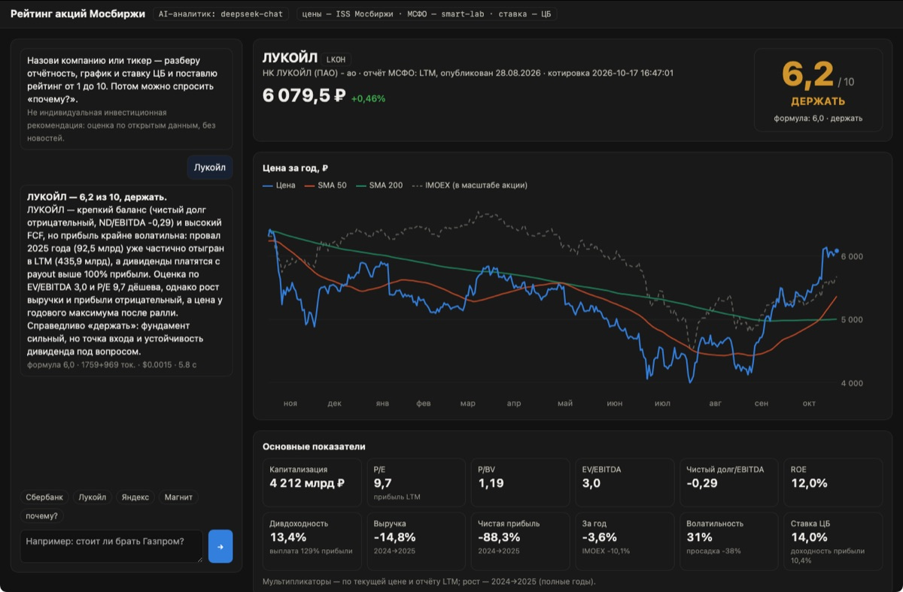
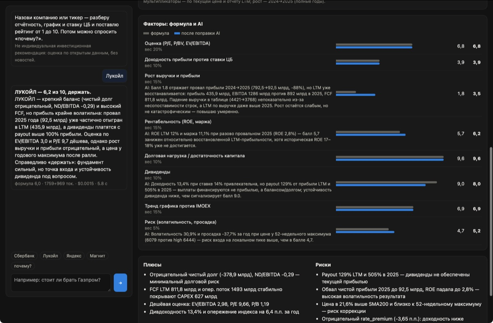

# 35 — Рейтинг акций Мосбиржи: отчётность + график + ставка ЦБ → оценка от 1 до 10

**Задание:** реальная задача, AI-приложение в реальном окружении (может работать не полностью
из-за ключей и доступов); описать задачу и роль AI.

**Задача:** компании регулярно публикуют отчётность. По запросу пользователя приложение
собирает свежий отчёт МСФО, биржевой график акции и ключевую ставку ЦБ. Дальше AI их
анализирует и даёт рекомендацию: покупать, держать или продавать. Веб-чат показывает
дашборд: график цены, основные показатели, баллы по факторам и итоговый **рейтинг от 1 до 10
с десятичной запятой**.

Это третий вариант дня 35. Первые два убраны из `main`, в истории git они остались:
- дашборды по открытым данным ХМАО (`7ce4e98`) — данные сырые и неоднородные;
- поиск цен на маркетплейсах (`e184ea5`) — Ozon и WB блокируют автоматизированный Safari.



## Запуск

```bash
cd 35-stock-rating
python3 web.py                      # http://localhost:8035 — чат и дашборд
python3 assistant.py "стоит ли покупать лукойл?" "почему не покупать, если дивиденды 13%?"
python3 analyst.py LKOH             # один разбор в консоль
python3 scoring.py LKOH 2025-04-01  # только формула, срез на дату
python3 rating_demo.py              # замер: 21 акция × 3 прогона + проверка задним числом (~3 мин)
python3 make_cast.py                # demo.svg
```

Нужен `DEEPSEEK_API_KEY` в корневом `.env`. Рынок, отчётность и ставка ЦБ берутся без ключей.

## Роль AI и роль кода

| Шаг | Кто | Что делает |
|---|---|---|
| Понять запрос | AI (`assistant.ROUTER`) + код | «лукойла», «сбер», «магнит» → тикер. Поиск по бирже на «магнит» первым отдаёт ММК, поэтому тикер угадывает модель, а код проверяет его на бирже |
| Данные | код | цены, IMOEX и число акций — ISS Мосбиржи; МСФО по годам и LTM — smart-lab; ключевая ставка — cbr.ru |
| Метрики и баллы | код (`scoring.py`) | P/E, P/BV, EV/EBITDA, долг/EBITDA, ROE, маржа, рост, дивдоходность, доходность прибыли против ставки, тренд против IMOEX, волатильность, просадка → 8 факторов по 1–10 → формульный рейтинг |
| Суждение | AI (`analyst.py`, deepseek-chat) | где баллы вводят в заблуждение (рост по двум годам, а LTM другой; дивиденды больше прибыли; банк — не завод), поправки к факторам с причиной, итоговый рейтинг, плюсы, риски, что отслеживать |
| Рекомендация | код | из рейтинга по одним порогам с формулой: ≥ 7,0 — покупать, 4,5–6,9 — держать, < 4,5 — продавать. Модель не может написать «покупать» при 4,1 |
| Вопросы «почему?» | AI | отвечает по тем же данным и своему разбору, без новостей и выдуманных цифр |

Арифметику модели не доверяем: P/E и доли она получает готовыми. От AI нужно то, чего нет в
формуле. Пример из прогона (Лукойл): формула дала росту 1,8 балла — прибыль 2025 года упала
на 88%. AI поднял балл до 3,5: прибыль за LTM уже 436 млрд против 92,5 млрд за 2025-й. Балл
дивидендов он, наоборот, понизил с 9,0 до 8,0: выплата составляет 129% прибыли, долго так
не будет.



## Как устроено

```
сообщение ─► assistant.resolve ─► тикер
                                   │
          snapshot.take(тикер, as_of=None)
          ├── moex.py     ISS: котировка, 2 года свечей акции и IMOEX   (кэш data/cache/)
          ├── reports.py  smart-lab /q/<T>/f/y/MSFO/: годы + LTM, даты публикации
          └── key_rate    cbr.ru: ключевая ставка на дату
                                   │
          scoring.score ─► метрики, 8 факторов 1–10, формула
                                   │
          analyst.analyze (deepseek-chat, JSON) ─► поправки, рейтинг, плюсы/риски
                                   │
          web.py ─► дашборд: цена, график (SVG, наведение), плитки, факторы, итог
```

`as_of` — срез «как было на дату»: свечи до неё, только опубликованные к ней годовые отчёты
(по датам публикации smart-lab), без LTM, ставка ЦБ на тот день. На нём построена проверка
задним числом.

Веса факторов: оценка 20%, доходность прибыли против ставки 10%, рост 15%, рентабельность
15%, долг 10%, дивиденды 10%, тренд 15%, риск 5%. Если у фактора нет данных (у банка нет
EBITDA, у Роснефти нет долга за 2025-й), он выпадает, и его вес делится между остальными.

## Результаты (`python3 rating_demo.py`, 17.10.2026)

### A. Сейчас: 21 акция × 3 прогона, temperature=0

| Тикер | Формула | AI, 3 прогона | AI: рекомендация |
|---|---|---|---|
| SBER | 7,6 покупать | 7,2 / 7,2 / 7,2 | покупать |
| T | 7,5 покупать | 7,0 / 6,8 / 6,8 | **покупать → держать → держать** |
| TATN | 6,5 держать | 6,6 / 6,6 / 6,6 | держать |
| LKOH | 6,0 держать | 6,2 / 6,2 / 6,2 | держать |
| VTBR | 6,5 держать | 5,8 / 5,8 / 5,8 | держать |
| MTSS | 6,9 держать | 6,4 / 6,4 / 6,2 | держать |
| PLZL | 5,3 держать | 4,9 / 4,9 / 4,6 | держать |
| OZON | 4,9 держать | 5,6 / 5,6 / 5,6 | держать |
| NLMK | 4,6 держать | 4,3 / 4,3 / 4,3 | **продавать** |
| PHOR | 4,6 держать | 4,2 / 4,2 / 4,2 | **продавать** |
| AFLT | 5,0 держать | 4,3 / 4,3 / 4,3 | **продавать** |
| MGNT | 2,9 продавать | 3,2 / 3,2 / 3,2 | продавать |

Остальные девять (MOEX, ROSN, GAZP, NVTK, GMKN, ALRS, CHMF, X5, YDEX) — в
`data/rating_demo.log`. Там AI отходит от формулы на 0–0,5 и рекомендацию не меняет.

| Метрика | DeepSeek |
|---|---|
| Разброс рейтинга между тремя прогонами | в среднем 0,05, максимум 0,3 |
| Рекомендация менялась между прогонами | 1 из 21 (T: 7,0 → 6,8, ровно на пороге) |
| Отклонение от формулы | в среднем −0,17, по модулю 0,37 |
| Рекомендация совпала с формулой | 18 из 21 |
| Словесная рекомендация расходится с собственным рейтингом | 0 из 63 |
| Рейтинг против «формулы после его же поправок» | расходится в среднем на 0,37 |
| Токенов / $ / секунд на разбор | 2 622 / $0.0014 / 5,0 с |

Все три расхождения с формулой (NLMK, PHOR, AFLT) — в одну сторону: AI понижает до
«продавать». Причина везде одна: формула считает рост по двум полным годам, а AI видит, что
LTM хуже. У Аэрофлота дивидендная доходность 14,5% даёт формуле 9,5 балла, AI ставит 4,0:
«payout 112% при отрицательном FCF — выплата не из прибыли».

AI умеет и восполнить пробел. У Роснефти за 2025 год и LTM нет долга, поэтому формула
выбросила этот фактор. AI вернул его с баллом 4,0 по долгу за 2024 год и сказал об этом прямо.
В той же оценке видно и обратное: он написал «EV/EBITDA ~5–6x», а этого числа во входе не
было — модель досчитала его сама, хотя просили не пересчитывать.

### B. Задним числом: можно ли было на это заработать

Срезы на 2025-04-01 и 2025-10-01, по 20 акций (X5 торгуется с января 2025 — года графика
нет). Оценивается доходность за следующие 12 месяцев минус IMOEX, всего 40 наблюдений.
Название скрыто («Компания X»): иначе модель могла бы вспомнить, чем всё кончилось. Для
проверки утечки тот же срез прогнан ещё и с названием.

| Рейтинг | Корреляция Спирмена с будущей доходностью к IMOEX | 04.2025 | 10.2025 | Верхняя треть | Нижняя треть |
|---|---|---|---|---|---|
| Формула | **+0,06** | −0,08 | +0,34 | −3,4 п.п. | −2,2 п.п. |
| DeepSeek, без названия | **+0,16** | −0,08 | +0,50 | +0,8 п.п. | −2,2 п.п. |
| DeepSeek, с названием | +0,20 | +0,01 | +0,48 | +0,8 п.п. | −0,9 п.п. |

| | Сколько раз | Обогнали IMOEX | В среднем к IMOEX |
|---|---|---|---|
| Формула: «покупать» | 9 | 6 | +0,5 п.п. |
| AI: «покупать» | 3 | 3 | +11,5 п.п. |
| Формула: «продавать» | 7 | отстали 4 | −2,7 п.п. |
| AI: «продавать» | 12 | отстали 6 | −2,8 п.п. |

**Как это честно читать:**
- При 20 наблюдениях корреляция значима (p < 0,05) примерно от 0,45. Её превысил только AI
  в одном окне из двух (октябрь 2025: +0,50). В апрельском окне и формула, и AI — ноль.
  Это не «AI предсказывает рынок», это слабый сигнал на маленькой выборке.
- Три «покупать» у AI, и все обогнали индекс. Но это две компании: Татнефть дважды и Сбер.
  Формула тоже их покупала — и вместе с ними Полюс, который в октябрьском окне отстал от
  индекса на 45 п.п. AI выигрывает осторожностью: он чаще ставит «держать», чем формула.
- Доходность считается без дивидендов. У Сбера, Татнефти и Лукойла с их 10–13% это
  заметно занижает результат.
- Утечка будущего небольшая: с названием рейтинг в среднем выше на 0,12. Корреляция с
  названием чуть лучше (0,20 против 0,16), так что полностью исключить «память» модели нельзя.

## Найденная ошибка в данных: неполный LTM

В первом прогоне (`data/rating_result_v1.json`, `data/rating_demo_v1.log`) AI понизил
Полюс до 4,2 («продавать») с причиной «EBITDA LTM упала на 43%». Проверка показала, что
EBITDA не падала. Smart-lab складывает LTM из полугодий, а в отчёте за 2026Q2 строки
EBITDA у Полюса нет. «EBITDA LTM 293,7» оказалась суммой за одно полугодие. Та же история
у НЛМК (нет EBITDA за 2026Q1) и Алросы (нет EBITDA, долга и денежного потока).

Исправление в `reports.gaps_in_ltm`. Строка LTM считается полной, только если она
заполнена во всех кварталах текущего года, опубликованных к дате LTM. Иначе в LTM ставится
пусто, метрика берётся за последний полный год, а модели передаётся список таких строк.
После исправления формула для Полюса — 5,3, AI — 4,9 «держать». В разборе он сам пишет:
«ND/EBITDA посчитан на устаревшей EBITDA (LTM пустая)».

Заодно найдена вторая ловушка того же источника: `0.00` в строке «Чистый долг» при пустом
«Долге» — это заглушка, а не нулевой долг. В промежуточной версии исправления Роснефть из-за
неё получила «долг/EBITDA = 0» и 9,5 балла за долговую нагрузку. Теперь такие нули считаются
отсутствием данных.

Важно для оценки AI. Модель **не заметила** ни одной из этих ошибок: она уверенно
объясняла несуществующее падение EBITDA. Проверка данных — работа кода, а не модели.

## Демо



58 секунд: разбор Лукойла и Магнита (формула → поправки AI с причинами → итог и три
прогона), затем итоги частей A и B. Каст собран из `data/rating_result.json`. Настоящее
видео на этой машине не снять: нет ffmpeg, а `screencapture` требует разрешения Screen
Recording. Скриншоты дашборда сняты через Safari WebDriver с живого `web.py`.

## Выводы

1. **Рейтинг воспроизводим.** При temperature=0 разброс между прогонами — 0,05.
   Рекомендация менялась только там, где рейтинг лёг ровно на порог (Т-Технологии: 7,0 / 6,8).
2. **AI полезен как редактор формулы, а не вместо неё.** Он находит то, что формула
   считает механически: LTM против годов, дивиденды больше прибыли, разовый провал года.
   Все его сильные расхождения с формулой понятны и подкреплены цифрами.
3. **Но своим поправкам он следует нестрого.** Итоговый рейтинг расходится со
   средневзвешенным «после его же поправок» в среднем на 0,37. Поправки — объяснение, а не
   расчёт.
4. **Предсказательная сила задним числом — на уровне шума**, с одним значимым окном из
   двух. Рейтинг описывает компанию по отчётности и графику. Будущую доходность на рынке,
   где за год IMOEX упал на 6–14%, он не гарантирует.
5. **Модель доверяет данным.** Неполный LTM она принимает за факт и строит на нём красивое
   объяснение. Проверять источник должен код.

**Оговорки.** Smart-lab — вторичный источник: первоисточник e-disclosure.ru отвечает
скрипту 403, а отчёты там в PDF. Новостей, прогнозов менеджмента и консенсуса аналитиков в
данных нет. Привилегированные акции учтены в P/E как равные обыкновенным. Пороги шкал
подобраны под российский рынок 2024–2026 годов (ставка ЦБ 14–21%). Это не индивидуальная
инвестиционная рекомендация.

Стоимость всего замера (63 текущих разбора + 80 задним числом) — $0.19.
